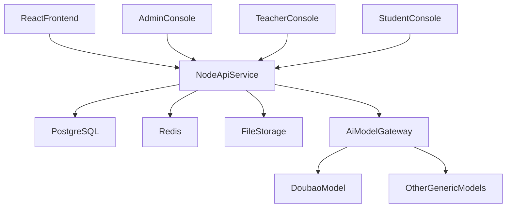
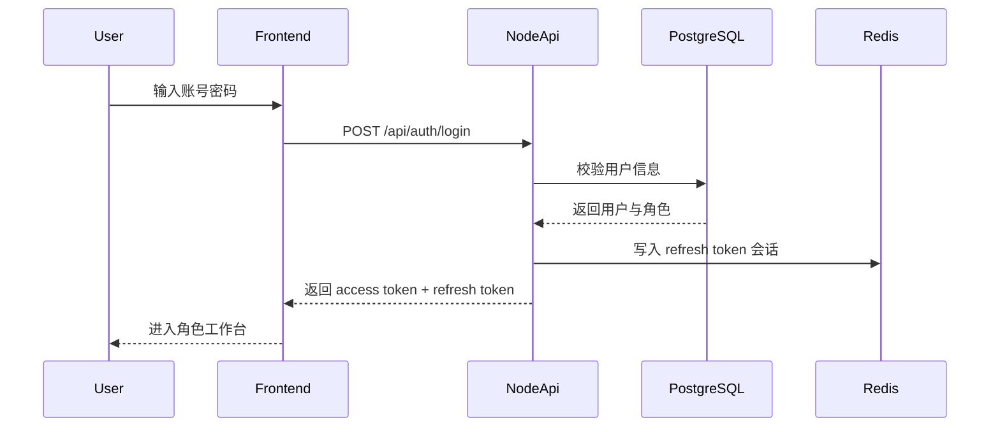

# 大学生创业实训平台全新项目设计方案

## 1. 文档定位

本文档基于当前已存在的 React 前端页面、路由结构与 mock 数据重新抽象，不复用旧设计方案内容。  
目标是形成一份可直接指导后续前后端开发的完整方案，支撑项目从“仅前端 UI 交互演示”演进为“前后端分离、可部署、可交付、可验收”的正式系统。

适用范围：
- 前端：现有 React + Vite 前端工程
- 后端：Node.js + PostgreSQL + Redis
- 部署：Docker / Docker Compose
- AI：默认接入火山引擎豆包通用模型，并支持切换其他通用模型

---

## 2. 项目背景与建设目标

### 2.1 当前项目现状

当前项目已经具备较完整的前端交互原型，包含：
- 门户首页、学生中心、教师看板、管理员后台
- 创业实训全流程模块：组队、创意生成、市场调研、产品设计、商业模式、AI 仿真、商业计划书、教学评价
- 课程知识体系、任务管理、审核流程、学习进度、通知、运营日志等 UI

当前缺失内容主要包括：
- 真实登录认证与权限体系
- 后端业务接口与数据库持久化
- Redis 缓存与会话管理
- AI 模型调用网关与后台配置能力
- 文件上传下载、审核流、通知流、评分流的后端实现
- Docker 化部署与正式交付标准

### 2.2 建设目标

建设一套面向高校创新创业课程的前后端分离平台，支持学生、教师、管理员三类角色完成完整教学闭环：
- 学生完成知识学习、团队协作、项目实训、成果提交与复盘
- 教师完成班级管理、任务发布、过程监控、审核与评价
- 管理员完成用户治理、课程资源管理、AI 模型配置、系统审计与运维支持

### 2.3 核心目标

1. 基于现有前端交互快速落地后端系统，减少二次返工。
2. 形成统一的数据模型、接口规范、部署规范与验收标准。
3. 将 AI 能力纳入正式系统架构，而不是仅作为前端演示效果。
4. 支持未来继续扩展模型提供商、课程模块、统计分析与运营能力。

---

## 3. 角色与业务模块需求分析

### 3.1 用户角色定义

| 角色 | 核心职责 | 典型页面 |
|------|----------|----------|
| 学生 | 学习课程、参与组队、完成实训任务、提交成果、接收反馈 | 首页、学生中心、知识系统、实训模块页 |
| 教师 | 监控教学过程、管理班级与学生、发布任务、审核成果、评分评价 | 教师看板、课程设置、班级项目总览 |
| 管理员 | 管理用户、班级、课程资源、日志与系统配置 | 管理后台 |

### 3.2 学生端业务模块

#### 3.2.1 门户与登录
- 支持账号密码登录
- 登录后按角色跳转到对应工作台
- 首页支持实训模块入口、帮助中心、平台概览展示

#### 3.2.2 学生中心
- 进度看板：展示模块完成率、阶段状态、能力成长情况
- 实践课程：展示知识点、资源、测验、学习记录
- 能力点管理：展示能力点来源、等级、成长轨迹
- 学习档案：展示学习记录、任务记录、评价结果
- 消息通知：接收教师引导、系统提醒、评价反馈

#### 3.2.3 创业实训模块

1. 组队与团队管理
- 创建或加入团队
- 查看成员信息、角色分工、团队状态
- 支持组队审核与教师干预

2. 创新思维与创意生成
- 记录创意生成过程
- 保存创意方案、多轮筛选结果与教师建议
- 支持 AI 辅助创意拓展

3. 市场调研与用户画像
- 编写调研计划
- 创建问卷、跟踪回收情况
- 录入调研分析结论与用户画像

4. 产品设计与原型
- 记录功能设计、页面结构、原型说明
- 管理产品版本与迭代记录
- 支持 AI 辅助产品结构分析

5. 商业模式设计
- 完成商业模式画布
- 录入价值主张、客户细分、渠道、收入成本结构
- 支持 SWOT、市场模拟等分析

6. AI 仿真模拟 / 验证
- 对项目方案进行“挑剔用户/竞争对手/投资人”等多视角挑战
- 记录多轮对话、问题、修复建议与处理结果

7. 商业计划书
- 维护商业计划书内容
- 上传计划书附件与路演 PPT
- 提交教师审核并接收反馈

8. 教学评价与复盘
- 查看阶段评价、最终评分、加分项
- 查看复盘建议与改进方向

### 3.3 教师端业务模块

#### 3.3.1 教学监控
- 全局查看班级团队进度
- 查看风险团队、滞后模块、提交情况、活跃度
- 提供动态引导与干预建议

#### 3.3.2 班级与学生管理
- 班级增删改查
- 学生导入、学生分配、学生状态管理
- 查看学生学习进度与能力成长

#### 3.3.3 任务与审核
- 创建任务、指定目标团队、设置截止时间、上传任务附件
- 审核组队结果
- 审核选题内容
- 审核商业计划书及相关成果

#### 3.3.4 教学评价
- 基于过程与成果进行双维评分
- 管理评分标准、权重与复盘加分规则
- 输出评价结果与反馈建议

#### 3.3.5 课程设置
- 设置模块截止时间
- 设置评分规则与课程参数
- 控制课程可见性与教学节奏

### 3.4 管理端业务模块

#### 3.4.1 数据概览
- 查看用户总数、班级总数、课程数、活跃情况、资源审核状态等

#### 3.4.2 用户管理
- 用户新增、编辑、禁用、重置密码
- 学生、教师、管理员角色管理
- 批量导入用户

#### 3.4.3 班级管理
- 班级创建与维护
- 班级与教师绑定
- 班级状态管理

#### 3.4.4 课程资源管理
- 课程审核、上架、下架
- 知识点资源库管理
- 案例库管理
- 待审核资源处理

#### 3.4.5 AI 模型配置中心
- 配置默认模型提供商
- 配置豆包及其他通用模型
- 维护模型启停状态、超时、温度、密钥等参数
- 查看模型调用日志、错误率与切换策略

#### 3.4.6 系统配置（库内）
- 站点与品牌、安全/JWT、上传策略、SMTP、短信、AI 全局限流与超时、RTC 扩展占位等
- 配置写入 PostgreSQL `system_config`，由 Node 读取并可配合 Redis 短缓存；**不依赖前端 `.env` 业务密钥**
- 管理端提供「系统配置」页（如 `/admin-dashboard?tab=system-config`），接口约定：`GET/PATCH /api/admin/system-config`

#### 3.4.7 操作日志与审计
- 记录用户操作、配置变更、审核行为、登录行为
- 支持按时间、用户、模块、类型查询

---

## 4. 系统总体架构设计

### 4.1 技术栈

| 层级 | 技术方案 |
|------|----------|
| 前端 | React 19 + Vite + React Router；**现有页面以 Tailwind CSS 为主**；**新增能力可使用 TDesign React**（已在入口引入组件库样式与 React 19 适配；与 Tailwind 并存时注意样式优先级） |
| 后端 | Node.js 20 + Express / Nest 风格分层设计 |
| 数据库 | PostgreSQL 15+ |
| 缓存 | Redis 7+ |
| 文件存储 | 本地持久卷起步，后续可扩展对象存储 |
| 认证 | JWT Access Token + Refresh Token |
| AI 调用 | AI 网关服务 + 火山引擎豆包默认适配器 |
| 部署 | Docker + Docker Compose |
| 日志与监控 | 结构化日志 + 健康检查 + 指标采集 |

### 4.2 架构目标

- 前后端职责清晰，接口契约统一
- 核心业务数据由 PostgreSQL 持久化
- 高频读取、登录状态、通知计数、统计看板由 Redis 提升性能
- AI 模型接入通过统一适配层，避免业务代码直接耦合单一厂商
- 方案支持单机部署起步，并兼容后续横向扩展

### 4.3 系统架构图



### 4.4 后端分层设计

1. 接口层
- 负责路由、鉴权、参数校验、统一响应输出

2. 应用服务层
- 负责业务编排，如任务发布、审核流程、AI 调用封装、通知分发

3. 领域服务层
- 按业务域拆分：用户、班级、课程、团队、任务、审核、评价、AI 配置

4. 数据访问层
- 负责 PostgreSQL 表操作、事务管理、查询优化

5. 缓存层
- 负责 Redis 读写、热点缓存、会话、计数器

6. 集成适配层
- 负责第三方模型、文件服务、通知服务等对接

7. 运维观测层
- 负责日志、监控、告警、健康检查、审计追踪

---

## 5. 后端功能架构与领域模块设计

### 5.1 领域模块划分

| 模块 | 说明 |
|------|------|
| auth | 登录、刷新令牌、登出、密码管理、会话控制 |
| user | 用户管理、角色管理、账号状态、批量导入 |
| org | 班级、教师关联、学生归属、学期维度管理 |
| course | 课程、章节、知识点、案例资源、课程设置 |
| team | 团队创建、成员管理、组队审核、角色分工 |
| project | 创意、调研、产品设计、商业模式、AI 验证、计划书等项目过程数据 |
| task | 任务发布、附件、目标范围、提交记录 |
| review | 选题审核、计划书审核、资源审核、审核记录 |
| evaluation | 评分标准、教学评价、阶段评分、终评与复盘 |
| notification | 系统通知、教师引导、反馈消息、已读状态 |
| ai | 模型配置、模型切换、提示词模板、调用日志、失败回退 |
| audit | 操作日志、登录日志、配置变更日志 |
| file | 文件上传、下载、归属校验、元数据管理 |

### 5.2 API 分组建议

- `/api/auth/*`
- `/api/users/*`
- `/api/classes/*`
- `/api/courses/*`
- `/api/resources/*`
- `/api/teams/*`
- `/api/projects/*`
- `/api/tasks/*`
- `/api/reviews/*`
- `/api/evaluations/*`
- `/api/notifications/*`
- `/api/admin/models/*`
- `/api/admin/logs/*`
- `/api/files/*`

### 5.3 统一接口约定

- 统一前缀：`/api`
- 统一响应结构：`code`、`message`、`data`、`traceId`
- 统一分页参数：`page`、`pageSize`、`sortBy`、`order`
- 统一错误码分层：认证类、权限类、参数类、业务冲突类、系统异常类
- 创建、提交、审核等接口支持幂等键 `Idempotency-Key`

统一响应示例：

```json
{
  "code": 0,
  "message": "OK",
  "data": {
    "items": [],
    "total": 0
  },
  "traceId": "req_20260421_xxxx"
}
```

---

## 6. AI 模型能力与配置中心设计

### 6.1 AI 设计目标

- 默认使用火山引擎豆包通用模型
- 支持切换其他通用大模型提供商
- 对业务模块屏蔽底层模型差异
- 在后台可视化维护模型配置，不需要改代码即可切换

### 6.2 AI 能力应用场景

| 场景 | 说明 |
|------|------|
| 创意生成 | 生成创意点子、创意扩展、问题拆解 |
| 角色推荐 | 根据团队成员能力推荐团队分工 |
| 市场调研辅助 | 生成调研提纲、问卷优化、用户画像总结 |
| 产品设计辅助 | 生成功能建议、MVP 拆解、原型结构说明 |
| 商业模式辅助 | 输出价值主张、竞争分析、商业模式建议 |
| AI 仿真验证 | 多角色挑战项目逻辑，输出风险与修复建议 |
| 商业计划书辅助 | 生成章节初稿、润色内容、补全结构 |
| 教学评价辅助 | 生成阶段评价建议、风险提示、反馈摘要 |

### 6.3 AI 网关设计

AI 调用不直接散落在各业务模块中，而统一经过 `AiModelGateway`：

1. 业务模块提交任务请求
2. AI 网关根据场景获取默认模型配置
3. 组装 Prompt 模板、上下文、调用参数
4. 分发到具体模型适配器（豆包 / 其他模型）
5. 记录调用日志、耗时、状态码、token 消耗、错误信息
6. 返回结构化结果给业务模块

### 6.4 模型适配器设计

建议定义统一适配接口：
- `chatCompletion()`
- `textGeneration()`
- `structuredOutput()`
- `healthCheck()`

每个提供商通过单独适配器实现：
- `DoubaoAdapter`
- `OpenAICompatibleAdapter`
- `OtherGeneralModelAdapter`

### 6.5 管理后台模型配置中心

管理后台新增“AI 模型配置中心”，建议包含以下能力：

1. 提供商管理
- 提供商名称
- 提供商类型
- 默认 Base URL
- 启停状态

2. 模型配置管理
- 模型名称
- 模型编码
- 所属提供商
- API Key / Secret / Access Token
- Base URL
- 默认温度、最大 Token、超时时间
- 是否默认模型
- 是否启用
- 失败回退优先级

3. Prompt 模板管理
- 按业务场景维护 Prompt 模板
- 支持版本管理、回滚与启停

4. 调用日志管理
- 请求时间
- 调用场景
- 调用模型
- 输入摘要
- 输出摘要
- 耗时
- 是否成功
- 错误信息

### 6.6 默认模型策略

- 默认提供商：火山引擎
- 默认模型：豆包通用模型
- 当默认模型超时、不可用或错误率连续超阈值时，可切换至备用通用模型
- 模型切换必须记录审计日志

---

## 7. PostgreSQL 数据库设计

### 7.1 设计原则

- 所有核心业务数据进入 PostgreSQL 持久化
- 所有关键表统一包含审计字段：`created_at`、`updated_at`
- 审核、评分、配置变更等关键操作保留操作人和时间
- 高频查询字段建立索引
- 通过外键、唯一约束和状态字段保证数据一致性

### 7.2 用户与组织域

#### 7.2.1 users

| 字段 | 类型 | 说明 |
|------|------|------|
| id | bigserial PK | 用户主键 |
| username | varchar(64) unique | 登录账号 |
| password_hash | varchar(255) | 密码哈希 |
| real_name | varchar(64) | 真实姓名 |
| email | varchar(128) | 邮箱 |
| phone | varchar(32) | 手机号 |
| role | varchar(32) | `student/teacher/admin` |
| status | varchar(32) | `active/disabled/pending` |
| student_no | varchar(64) | 学号 |
| employee_no | varchar(64) | 工号 |
| department | varchar(128) | 学院/部门 |
| last_login_at | timestamptz | 最近登录时间 |
| created_at | timestamptz | 创建时间 |
| updated_at | timestamptz | 更新时间 |

索引建议：
- `uk_users_username`
- `idx_users_role_status`
- `idx_users_department`

#### 7.2.2 classes

| 字段 | 类型 | 说明 |
|------|------|------|
| id | bigserial PK | 班级主键 |
| name | varchar(128) | 班级名称 |
| code | varchar(64) unique | 班级编码 |
| academic_year | varchar(32) | 学年 |
| semester | varchar(32) | 学期 |
| department | varchar(128) | 所属学院 |
| teacher_id | bigint FK | 班主任/授课教师 |
| status | varchar(32) | 班级状态 |
| created_at | timestamptz | 创建时间 |
| updated_at | timestamptz | 更新时间 |

#### 7.2.3 class_students

| 字段 | 类型 | 说明 |
|------|------|------|
| id | bigserial PK | 主键 |
| class_id | bigint FK | 班级 ID |
| student_id | bigint FK | 学生 ID |
| joined_at | timestamptz | 加入时间 |

唯一约束：
- `(class_id, student_id)`

### 7.3 课程与资源域

#### 7.3.1 courses

| 字段 | 类型 | 说明 |
|------|------|------|
| id | bigserial PK | 课程主键 |
| name | varchar(200) | 课程名称 |
| description | text | 课程描述 |
| teacher_id | bigint FK | 授课教师 |
| department | varchar(128) | 所属学院 |
| status | varchar(32) | `draft/pending/approved/rejected/offline` |
| reject_reason | text | 驳回原因 |
| is_published | boolean | 是否发布 |
| created_at | timestamptz | 创建时间 |
| updated_at | timestamptz | 更新时间 |

#### 7.3.2 course_modules

| 字段 | 类型 | 说明 |
|------|------|------|
| id | bigserial PK | 模块主键 |
| course_id | bigint FK | 课程 ID |
| name | varchar(128) | 模块名称 |
| sort_order | int | 排序 |
| is_enabled | boolean | 是否启用 |
| created_at | timestamptz | 创建时间 |

#### 7.3.3 knowledge_points

| 字段 | 类型 | 说明 |
|------|------|------|
| id | bigserial PK | 知识点主键 |
| course_id | bigint FK | 所属课程 |
| module_id | bigint FK | 所属模块 |
| title | varchar(200) | 标题 |
| description | text | 描述 |
| resource_type | varchar(32) | `video/document/graphic/case` |
| ability_point_name | varchar(128) | 对应能力点 |
| duration_minutes | int | 时长 |
| status | varchar(32) | `draft/published/offline` |
| uploader_id | bigint FK | 上传人 |
| is_public | boolean | 是否公开 |
| created_at | timestamptz | 创建时间 |
| updated_at | timestamptz | 更新时间 |

#### 7.3.4 cases

| 字段 | 类型 | 说明 |
|------|------|------|
| id | bigserial PK | 案例主键 |
| course_id | bigint FK | 所属课程 |
| title | varchar(200) | 案例标题 |
| industry | varchar(128) | 行业 |
| case_type | varchar(32) | `success/failure` |
| module_name | varchar(128) | 所属模块 |
| description | text | 简介 |
| is_recommended | boolean | 是否推荐 |
| status | varchar(32) | `draft/published/offline` |
| uploader_id | bigint FK | 上传人 |
| created_at | timestamptz | 创建时间 |
| updated_at | timestamptz | 更新时间 |

#### 7.3.5 ability_points

| 字段 | 类型 | 说明 |
|------|------|------|
| id | bigserial PK | 主键 |
| name | varchar(128) | 能力点名称 |
| category | varchar(64) | 核心能力/专业能力/通用能力 |
| description | text | 描述 |
| max_level | int | 最大等级 |
| created_at | timestamptz | 创建时间 |

#### 7.3.6 student_ability_records

| 字段 | 类型 | 说明 |
|------|------|------|
| id | bigserial PK | 主键 |
| student_id | bigint FK | 学生 |
| ability_point_id | bigint FK | 能力点 |
| current_level | int | 当前等级 |
| source_type | varchar(64) | 来源类型 |
| source_ref_id | bigint | 来源业务 ID |
| obtained_at | timestamptz | 获得时间 |

### 7.4 团队与项目域

#### 7.4.1 teams

| 字段 | 类型 | 说明 |
|------|------|------|
| id | bigserial PK | 团队主键 |
| class_id | bigint FK | 所属班级 |
| course_id | bigint FK | 所属课程 |
| name | varchar(128) | 团队名称 |
| leader_id | bigint FK | 队长 |
| status | varchar(32) | `forming/pending_review/active/rejected/archived` |
| current_stage | varchar(64) | 当前阶段 |
| overall_progress | numeric(5,2) | 总进度 |
| collaboration_score | numeric(5,2) | 协作分 |
| quality_score | numeric(5,2) | 质量分 |
| risk_level | varchar(32) | `normal/warning/high` |
| created_at | timestamptz | 创建时间 |
| updated_at | timestamptz | 更新时间 |

#### 7.4.2 team_members

| 字段 | 类型 | 说明 |
|------|------|------|
| id | bigserial PK | 主键 |
| team_id | bigint FK | 团队 |
| user_id | bigint FK | 用户 |
| team_role | varchar(64) | 团队内角色 |
| join_status | varchar(32) | `invited/accepted/rejected` |
| joined_at | timestamptz | 加入时间 |

唯一约束：
- `(team_id, user_id)`

#### 7.4.3 team_stage_progress

| 字段 | 类型 | 说明 |
|------|------|------|
| id | bigserial PK | 主键 |
| team_id | bigint FK | 团队 |
| stage_code | varchar(64) | `team/ideation/market/product/business/simulation/plan/evaluation` |
| progress_percent | numeric(5,2) | 进度百分比 |
| status | varchar(32) | `not_started/in_progress/completed` |
| updated_by | bigint FK | 操作人 |
| updated_at | timestamptz | 更新时间 |

#### 7.4.4 project_topics

| 字段 | 类型 | 说明 |
|------|------|------|
| id | bigserial PK | 主键 |
| team_id | bigint FK | 团队 |
| project_name | varchar(200) | 项目名称 |
| direction | varchar(128) | 方向 |
| description | text | 项目描述 |
| target_users | text | 目标用户 |
| core_value | text | 核心价值 |
| market_size | text | 市场规模 |
| competitive_advantage | text | 竞争优势 |
| status | varchar(32) | `draft/pending/approved/rejected` |
| submitted_at | timestamptz | 提交时间 |
| created_at | timestamptz | 创建时间 |
| updated_at | timestamptz | 更新时间 |

#### 7.4.5 market_research_plans

| 字段 | 类型 | 说明 |
|------|------|------|
| id | bigserial PK | 主键 |
| team_id | bigint FK | 团队 |
| goal | text | 调研目标 |
| methods | jsonb | 调研方法列表 |
| members | jsonb | 成员分工 |
| start_date | date | 开始日期 |
| end_date | date | 结束日期 |
| created_at | timestamptz | 创建时间 |
| updated_at | timestamptz | 更新时间 |

#### 7.4.6 surveys

| 字段 | 类型 | 说明 |
|------|------|------|
| id | bigserial PK | 主键 |
| team_id | bigint FK | 团队 |
| title | varchar(200) | 问卷标题 |
| status | varchar(32) | `draft/running/closed` |
| target_count | int | 目标数量 |
| collected_count | int | 已收集数量 |
| survey_link | varchar(500) | 问卷链接 |
| created_at | timestamptz | 创建时间 |
| updated_at | timestamptz | 更新时间 |

#### 7.4.7 survey_questions

| 字段 | 类型 | 说明 |
|------|------|------|
| id | bigserial PK | 主键 |
| survey_id | bigint FK | 问卷 |
| question_text | text | 题目 |
| question_type | varchar(32) | 单选/多选/评分/填空 |
| options | jsonb | 选项 |
| sort_order | int | 排序 |

#### 7.4.8 user_personas

| 字段 | 类型 | 说明 |
|------|------|------|
| id | bigserial PK | 主键 |
| team_id | bigint FK | 团队 |
| name | varchar(64) | 画像名称 |
| age | int | 年龄 |
| occupation | varchar(128) | 身份 |
| major | varchar(128) | 专业 |
| pain_points | jsonb | 痛点 |
| needs | jsonb | 需求 |
| habits | jsonb | 习惯 |
| created_at | timestamptz | 创建时间 |

#### 7.4.9 product_design_docs

| 字段 | 类型 | 说明 |
|------|------|------|
| id | bigserial PK | 主键 |
| team_id | bigint FK | 团队 |
| version_no | varchar(32) | 版本号 |
| feature_summary | text | 功能概述 |
| prototype_desc | text | 原型说明 |
| mvp_scope | text | MVP 范围 |
| iteration_notes | text | 迭代说明 |
| created_at | timestamptz | 创建时间 |
| updated_at | timestamptz | 更新时间 |

#### 7.4.10 business_models

| 字段 | 类型 | 说明 |
|------|------|------|
| id | bigserial PK | 主键 |
| team_id | bigint FK | 团队 |
| customer_segments | text | 客户细分 |
| value_propositions | text | 价值主张 |
| channels | text | 渠道 |
| customer_relationships | text | 客户关系 |
| revenue_streams | text | 收入来源 |
| key_resources | text | 核心资源 |
| key_activities | text | 核心活动 |
| key_partners | text | 核心伙伴 |
| cost_structure | text | 成本结构 |
| swot_analysis | text | SWOT 分析 |
| created_at | timestamptz | 创建时间 |
| updated_at | timestamptz | 更新时间 |

#### 7.4.11 business_plans

| 字段 | 类型 | 说明 |
|------|------|------|
| id | bigserial PK | 主键 |
| team_id | bigint FK | 团队 |
| project_name | varchar(200) | 项目名称 |
| executive_summary | text | 执行摘要 |
| market_analysis | text | 市场分析 |
| product_service | text | 产品与服务 |
| marketing_strategy | text | 营销策略 |
| operation_plan | text | 运营计划 |
| financial_plan | text | 财务计划 |
| team_introduction | text | 团队介绍 |
| risk_analysis | text | 风险分析 |
| status | varchar(32) | `draft/pending/approved/rejected` |
| submitted_at | timestamptz | 提交时间 |
| created_at | timestamptz | 创建时间 |
| updated_at | timestamptz | 更新时间 |

#### 7.4.12 business_plan_attachments

| 字段 | 类型 | 说明 |
|------|------|------|
| id | bigserial PK | 主键 |
| business_plan_id | bigint FK | 计划书 |
| file_id | bigint FK | 文件 |
| attachment_type | varchar(32) | `ppt/pdf/other` |
| created_at | timestamptz | 创建时间 |

#### 7.4.13 ai_validation_sessions

| 字段 | 类型 | 说明 |
|------|------|------|
| id | bigserial PK | 主键 |
| team_id | bigint FK | 团队 |
| session_name | varchar(200) | 会话名称 |
| selected_agents | jsonb | 参与角色 |
| project_plan_summary | text | 项目方案摘要 |
| status | varchar(32) | `running/completed/stopped` |
| started_at | timestamptz | 开始时间 |
| ended_at | timestamptz | 结束时间 |

#### 7.4.14 ai_validation_messages

| 字段 | 类型 | 说明 |
|------|------|------|
| id | bigserial PK | 主键 |
| session_id | bigint FK | 会话 |
| round_no | int | 轮次 |
| actor_type | varchar(32) | `user/picky_user/competitor/investor/system` |
| content | text | 内容 |
| severity | varchar(32) | `critical/warning/info` |
| suggestions | jsonb | 建议 |
| created_at | timestamptz | 创建时间 |

#### 7.4.15 ai_validation_records

| 字段 | 类型 | 说明 |
|------|------|------|
| id | bigserial PK | 主键 |
| session_id | bigint FK | 会话 |
| round_no | int | 轮次 |
| agent_name | varchar(64) | 智能体 |
| issue_title | varchar(255) | 问题 |
| user_response | text | 用户回应 |
| fix_status | varchar(32) | `fixed/pending/ignored` |
| created_at | timestamptz | 创建时间 |

### 7.5 任务、审核与评价域

#### 7.5.1 tasks

| 字段 | 类型 | 说明 |
|------|------|------|
| id | bigserial PK | 主键 |
| class_id | bigint FK | 班级 |
| course_id | bigint FK | 课程 |
| title | varchar(200) | 任务标题 |
| description | text | 任务描述 |
| module_code | varchar(64) | 任务所属模块 |
| deadline_at | timestamptz | 截止时间 |
| scope | varchar(32) | `all/specific` |
| status | varchar(32) | `draft/published/expired` |
| published_by | bigint FK | 发布人 |
| published_at | timestamptz | 发布时间 |
| created_at | timestamptz | 创建时间 |
| updated_at | timestamptz | 更新时间 |

#### 7.5.2 task_target_teams

| 字段 | 类型 | 说明 |
|------|------|------|
| id | bigserial PK | 主键 |
| task_id | bigint FK | 任务 |
| team_id | bigint FK | 目标团队 |

#### 7.5.3 task_attachments

| 字段 | 类型 | 说明 |
|------|------|------|
| id | bigserial PK | 主键 |
| task_id | bigint FK | 任务 |
| file_id | bigint FK | 文件 |
| created_at | timestamptz | 创建时间 |

#### 7.5.4 task_submissions

| 字段 | 类型 | 说明 |
|------|------|------|
| id | bigserial PK | 主键 |
| task_id | bigint FK | 任务 |
| team_id | bigint FK | 团队 |
| content | text | 提交内容 |
| status | varchar(32) | `submitted/reviewed/rejected` |
| score | numeric(5,2) | 分数 |
| feedback | text | 教师反馈 |
| submitted_at | timestamptz | 提交时间 |
| reviewed_at | timestamptz | 评审时间 |
| reviewed_by | bigint FK | 评审人 |
| created_at | timestamptz | 创建时间 |

#### 7.5.5 submission_attachments

| 字段 | 类型 | 说明 |
|------|------|------|
| id | bigserial PK | 主键 |
| submission_id | bigint FK | 提交记录 |
| file_id | bigint FK | 文件 |
| created_at | timestamptz | 创建时间 |

#### 7.5.6 review_records

| 字段 | 类型 | 说明 |
|------|------|------|
| id | bigserial PK | 主键 |
| review_type | varchar(64) | `team/topic/business_plan/resource/task_submission` |
| biz_id | bigint | 业务 ID |
| status | varchar(32) | `pending/approved/rejected` |
| comment | text | 审核意见 |
| reviewer_id | bigint FK | 审核人 |
| reviewed_at | timestamptz | 审核时间 |
| created_at | timestamptz | 创建时间 |

#### 7.5.7 evaluation_schemes

| 字段 | 类型 | 说明 |
|------|------|------|
| id | bigserial PK | 主键 |
| course_id | bigint FK | 课程 |
| name | varchar(128) | 评分方案名称 |
| process_weight | numeric(5,2) | 过程权重 |
| result_weight | numeric(5,2) | 成果权重 |
| collaboration_weight | numeric(5,2) | 协作权重 |
| review_bonus_weight | numeric(5,2) | 复盘加分权重 |
| is_default | boolean | 是否默认 |
| created_at | timestamptz | 创建时间 |

#### 7.5.8 evaluation_records

| 字段 | 类型 | 说明 |
|------|------|------|
| id | bigserial PK | 主键 |
| team_id | bigint FK | 团队 |
| course_id | bigint FK | 课程 |
| evaluator_id | bigint FK | 评价人 |
| project_score | numeric(5,2) | 项目完成度分 |
| iteration_score | numeric(5,2) | 迭代增值分 |
| review_bonus_score | numeric(5,2) | 复盘加分 |
| final_score | numeric(5,2) | 最终分 |
| feedback | text | 综合反馈 |
| created_at | timestamptz | 创建时间 |

### 7.6 系统配置与审计域

#### 7.6.1 ai_providers

| 字段 | 类型 | 说明 |
|------|------|------|
| id | bigserial PK | 主键 |
| provider_code | varchar(64) unique | 提供商编码 |
| provider_name | varchar(128) | 提供商名称 |
| base_url | varchar(255) | 默认地址 |
| auth_type | varchar(32) | 鉴权方式 |
| status | varchar(32) | `enabled/disabled` |
| created_at | timestamptz | 创建时间 |
| updated_at | timestamptz | 更新时间 |

#### 7.6.2 ai_models

| 字段 | 类型 | 说明 |
|------|------|------|
| id | bigserial PK | 主键 |
| provider_id | bigint FK | 提供商 |
| model_code | varchar(128) | 模型编码 |
| model_name | varchar(128) | 模型名称 |
| api_key_encrypted | text | 加密密钥 |
| api_secret_encrypted | text | 加密密钥 |
| base_url | varchar(255) | 调用地址 |
| temperature | numeric(4,2) | 温度 |
| max_tokens | int | 最大输出 |
| timeout_ms | int | 超时时间 |
| priority | int | 优先级 |
| is_default | boolean | 是否默认 |
| is_enabled | boolean | 是否启用 |
| created_at | timestamptz | 创建时间 |
| updated_at | timestamptz | 更新时间 |

#### 7.6.3 ai_prompt_templates

| 字段 | 类型 | 说明 |
|------|------|------|
| id | bigserial PK | 主键 |
| scene_code | varchar(64) | 场景编码 |
| template_name | varchar(128) | 模板名称 |
| template_content | text | 模板内容 |
| version_no | varchar(32) | 版本 |
| is_enabled | boolean | 是否启用 |
| created_by | bigint FK | 创建人 |
| created_at | timestamptz | 创建时间 |

#### 7.6.4 ai_call_logs

| 字段 | 类型 | 说明 |
|------|------|------|
| id | bigserial PK | 主键 |
| model_id | bigint FK | 模型 |
| scene_code | varchar(64) | 业务场景 |
| request_id | varchar(128) | 请求 ID |
| biz_type | varchar(64) | 业务类型 |
| biz_id | bigint | 业务 ID |
| input_summary | text | 输入摘要 |
| output_summary | text | 输出摘要 |
| duration_ms | int | 耗时 |
| token_usage | int | token 消耗 |
| is_success | boolean | 是否成功 |
| error_message | text | 错误信息 |
| created_at | timestamptz | 创建时间 |

#### 7.6.5 notifications

| 字段 | 类型 | 说明 |
|------|------|------|
| id | bigserial PK | 主键 |
| receiver_id | bigint FK | 接收人 |
| sender_id | bigint FK | 发送人 |
| type | varchar(32) | `guidance/reminder/evaluation/system` |
| title | varchar(255) | 标题 |
| content | text | 内容 |
| related_module | varchar(64) | 关联模块 |
| related_link | varchar(255) | 跳转路径 |
| is_read | boolean | 是否已读 |
| sent_at | timestamptz | 发送时间 |

#### 7.6.6 files

| 字段 | 类型 | 说明 |
|------|------|------|
| id | bigserial PK | 主键 |
| origin_name | varchar(255) | 原文件名 |
| storage_name | varchar(255) | 存储文件名 |
| storage_path | varchar(500) | 存储路径 |
| mime_type | varchar(128) | MIME 类型 |
| size_bytes | bigint | 文件大小 |
| uploader_id | bigint FK | 上传人 |
| biz_type | varchar(64) | 归属业务 |
| biz_id | bigint | 业务主键 |
| is_deleted | boolean | 是否删除 |
| created_at | timestamptz | 创建时间 |

#### 7.6.7 operation_logs

| 字段 | 类型 | 说明 |
|------|------|------|
| id | bigserial PK | 主键 |
| operator_id | bigint FK | 操作人 |
| operator_role | varchar(32) | 操作角色 |
| module | varchar(64) | 模块 |
| action | varchar(128) | 行为 |
| target_type | varchar(64) | 对象类型 |
| target_id | bigint | 对象 ID |
| detail | jsonb | 变更详情 |
| ip | varchar(64) | IP |
| created_at | timestamptz | 创建时间 |

#### 7.6.8 system_config（库内业务配置）

用于承载 **SMTP、短信、站点、JWT 策略、上传策略、AI 全局限流/超时** 等业务配置；**不依赖仓库 `.env`**。密钥类字段存于 JSON 内，接口层对管理员响应做 **掩码**，PATCH 合并写入时忽略掩码占位符，避免误覆盖。

| 字段 | 类型 | 说明 |
|------|------|------|
| config_key | varchar(64) PK | 配置键（见下表约定） |
| config_value | jsonb | 配置体（JSON） |
| description | text | 说明 |
| updated_at | timestamptz | 更新时间 |
| updated_by | bigint FK | 最后修改人（users.id） |

**`config_key` 与 JSON 结构约定（首期）**

| config_key | config_value 主要字段 | 说明 |
|------------|----------------------|------|
| site | `siteTitle`, `logoUrl` | 站点与品牌；`publicBaseUrl` 已弃用（前端不再编辑，旧库可仍存该键） |
| security | `jwt`: `accessTtlSec`, `refreshTtlSec`, `issuer`, `secret`；`passwordMinLength` | 会话与密码策略；JWT `secret` 为敏感字段 |
| upload | `maxSizeMb`, `allowedExtensions`（字符串数组） | 上传限制 |
| smtp_config | `host`, `port`, `secure`, `user`, `pass`, `from` | SMTP；`pass` 敏感 |
| sms_biz_config | `enabled`, `allowLogin`, `allowRegister`, `allowReset`, `expireSeconds`, `cooldownSeconds`, `dailyLimit` | 短信业务策略（与发码/限流路由配合） |
| aliyun_sms_config | `accessKeyId`, `accessKeySecret`, `signName`, `templateLogin`, `templateRegister`, `templateReset`, `regionId`, `endpoint`；兼容旧字段 `templateCode` | 阿里云短信；密钥敏感 |
| ai_global | `defaultTimeoutMs`, `maxRetries`, `logSampleRate`, `rateLimitPerUserPerMinute` | AI 调用全局默认与限流 |
| rtc_config | 任意 JSON | 预留给 RTC 等扩展（可空对象） |

可执行 SQL 见仓库 `docs/sql/`（`001_schema.sql` / `003_seed.sql`）。

### 7.7 与前端实训流程对齐的扩展表

下列表在首期 SQL 中已实现，用于补齐答题、学习进度、创意、BML 迭代、RBAC 与 AI 场景路由等能力；`users.role` 仍表示**主身份**，细粒度后台权限由 RBAC 表扩展。

| 表名 | 用途摘要 |
|------|----------|
| roles, permissions, role_permissions, user_roles | 角色、权限、关联；管理员菜单与接口鉴权扩展 |
| student_resource_progress | 学生对章节/资源的学习进度与完成度 |
| quizzes, quiz_questions, quiz_attempts | 测验、题目、作答与得分 |
| ideation_ideas, ideation_votes | 创意卡片与投票（团队维度） |
| team_iterations, team_iteration_metrics | 团队迭代周期与指标快照 |
| ai_scene_bindings | 业务场景编码 → 默认 `ai_models.id` |
| ai_jobs | 长任务/异步 AI 分析状态（可选，高并发下减轻同步阻塞） |

---

## 8. Redis 缓存与会话设计

### 8.1 Redis 使用目标

- 管理 Access Token / Refresh Token 状态
- 缓存热点详情和统计面板
- 维护通知未读数
- 提升课程、团队、任务等高频读场景性能

### 8.2 缓存键设计

| Key | 用途 | TTL |
|-----|------|-----|
| `auth:refresh:{userId}:{tokenId}` | Refresh Token 会话 | 7 天 |
| `auth:blacklist:{jti}` | Access Token 黑名单 | 15 分钟至过期 |
| `user:profile:{userId}` | 用户信息 | 1 小时 |
| `class:detail:{classId}` | 班级详情 | 30 分钟 |
| `course:detail:{courseId}` | 课程详情 | 1 小时 |
| `course:resource:list:{courseId}` | 课程资源列表 | 30 分钟 |
| `team:detail:{teamId}` | 团队详情 | 30 分钟 |
| `team:progress:{teamId}` | 团队阶段进度 | 10 分钟 |
| `task:list:{classId}` | 班级任务列表 | 15 分钟 |
| `notification:unread:{userId}` | 未读消息数 | 10 分钟 |
| `dashboard:teacher:{teacherId}` | 教师看板聚合数据 | 5 分钟 |
| `dashboard:admin:overview` | 管理后台概览 | 5 分钟 |
| `ai:model:default:{scene}` | 场景默认模型配置 | 10 分钟 |
| `cfg:system_config:all` | `system_config` 全表聚合快照（JSON） | 约 45～60 秒 |

### 8.3 缓存策略

- 读多写少的数据优先缓存
- 写操作遵循“数据库提交成功后删除缓存”原则
- 统计类缓存使用短 TTL，避免复杂实时强一致
- 大 Key 与热点 Key 纳入监控
- **`system_config` 与 AI 路由**：Node 启动与工作过程中读取 `system_config` 时可命中 `cfg:system_config:*`；管理员在后台 **PATCH 保存**后应 **`DEL` 或按前缀清除**该缓存键，避免旧 JWT 策略、限流等短期生效延迟。场景级默认模型可同时维护 `ai_scene_bindings` 与 `ai:model:default:{scene}`（或二选一以代码约定为准），**变更绑定关系时须失效对应场景缓存**。

### 8.4 会话策略

- Access Token：15 分钟
- Refresh Token：7 天
- 支持退出登录、强制下线、密码修改后令牌失效
- Refresh Token 存 Redis，并绑定 `userId + tokenId + device`

### 8.5 缓存保护

- 防穿透：空值缓存 + 参数校验
- 防击穿：热点 Key 互斥刷新
- 防雪崩：TTL 增加随机抖动

### 8.6 约 1000 并发下的部署与连接注意（设计层面）

- API **无状态**：JWT 校验不依赖进程内单机会话；Refresh / 黑名单等可放 Redis。
- PostgreSQL：**实例数 × 每实例连接池上限** 之和应 **小于** `max_connections`；扩容时同步调小单实例 pool，避免总连接打满。可选后续引入 **PgBouncer** 做连接池化。
- **水平扩展**：多副本 Node + 前置 Nginx **upstream**；Compose 单机可用 `scale node=2` 做思路验证。
- Redis：热点读、`ai_call_logs` 异步落库队列、配置短缓存等，降低数据库同步压力。

---

## 9. 核心业务流程设计

### 9.1 登录鉴权流程



### 9.2 学生实训推进流程

1. 学生加入团队或完成组队
2. 系统记录团队状态与阶段进度
3. 学生逐步完成知识学习、任务提交、项目数据录入
4. 教师发布引导、审核关键成果
5. 系统汇总进度、能力点与评价结果

### 9.3 教师审核流程

1. 教师查看待审核队列
2. 进入对应业务详情（组队/选题/计划书/资源）
3. 审核通过或驳回，并填写意见
4. 系统写入审核记录、更新业务状态、发送通知

### 9.4 AI 调用流程

1. 学生或教师触发 AI 场景
2. 后端根据场景选择默认模型配置
3. 网关组装 Prompt 并调用豆包或其他模型
4. 记录 AI 调用日志
5. 返回生成结果与摘要

### 9.5 管理后台模型配置流程

1. 管理员新增或编辑模型配置
2. 系统校验参数完整性并加密保存密钥
3. 管理员选择默认模型和备用模型
4. 系统清理缓存并刷新默认场景配置
5. 后续 AI 调用自动使用最新配置

---

## 10. 文件存储与安全设计

### 10.1 文件存储范围

- 任务附件
- 任务提交附件
- 商业计划书附件
- 路演 PPT
- 资源类文档、图文、视频元数据

### 10.2 文件策略

- 起步阶段使用 Docker Volume 映射本地持久目录
- 文件元数据统一入库到 `files`
- 下载必须经过后端鉴权，不直接暴露物理路径

### 10.3 安全要求

- 白名单扩展名校验
- MIME 类型校验
- 文件大小限制
- 文件名随机化与路径规范化
- 删除采用逻辑删除，便于审计

---

## 11. 安全、日志与可观测性

### 11.1 安全要求

- 所有敏感配置通过环境变量注入
- 密码使用强哈希算法存储
- JWT 使用签名密钥并支持轮换
- 管理后台关键操作需记录操作日志
- 文件下载、审核、模型配置等高权限行为需进行权限校验

### 11.2 日志规范

统一结构化日志字段建议：
- `timestamp`
- `level`
- `traceId`
- `userId`
- `module`
- `action`
- `durationMs`
- `statusCode`
- `errorCode`

### 11.3 指标与告警

建议监控以下指标：
- API QPS、错误率、P95/P99 响应时间
- PostgreSQL 连接数、慢查询、锁等待
- Redis 命中率、内存占用、热点 Key
- AI 调用成功率、平均耗时、超时率
- 容器 CPU、内存、重启次数

建议告警阈值：
- 5xx 错误率 > 1% 持续 5 分钟
- P95 > 800ms 持续 10 分钟
- Redis 内存使用率 > 85%
- PostgreSQL 连接池使用率 > 80%
- AI 调用失败率 > 10% 持续 10 分钟

---

## 12. Docker 部署与环境配置

### 12.1 部署组件

- `frontend`：React 静态资源服务
- `backend`：Node.js API 服务
- `postgres`：主数据库
- `redis`：缓存服务
- `nginx`：反向代理与静态资源入口

### 12.2 Docker Compose 设计建议

- 前后端、数据库、Redis 统一编排
- 数据目录挂载 Volume
- 服务间通过内部网络通信
- 后端依赖 PostgreSQL 与 Redis 健康状态

### 12.3 环境变量建议

**首期落地建议（与仓库 Docker 一致）**

- **不在仓库中提交 `.env` 文件**；本地/CI 也不强制复制 `.env.example`。
- **Docker Compose** 仅在 YAML 的 `environment:` 中内联 **容器互联** 所需项（如 `DATABASE_URL`、`REDIS_URL`、`POSTGRES_*`），用于 bootstrap；**这不等同于业务密钥文件**。
- **JWT Secret、第三方 API Key、SMTP 密码** 等一律落在 **`system_config` 与 `ai_*` 表**（或后续加密字段），由应用在运行时从数据库读取。

可选进程级变量（仍可为容器内联、非 `.env` 文件）：

- `NODE_ENV`、`PORT`
- `DATABASE_URL`（指向 `postgres` 服务）
- `REDIS_URL`（指向 `redis` 服务）

历史列表示例中的 `JWT_*`、大量 `DB_*` 拆分变量可在未使用 `DATABASE_URL` 的旧部署中保留；新编排以 **单连接串 + 库内 security** 为主。

### 12.4 健康检查

- `/api/health/live`：进程存活检查
- `/api/health/ready`：数据库、Redis 连通性检查
- （后续）`/api/health/ai`：默认模型健康检查

### 12.5 备份恢复

- PostgreSQL：每日全量备份 + WAL 归档
- Redis：RDB + AOF 按业务优先级配置
- 文件目录：每日归档备份

### 12.6 SQL 初始化与同域入口

- 业务库表与种子数据：`docs/sql/` 按 README 顺序 **`psql -f`** 导入；Docker 可将该目录挂载到 PostgreSQL 镜像的 `docker-entrypoint-initdb.d` 做首次初始化。
- **同域**：浏览器仅访问 **单端口（如 3000）**；Nginx 将 **`/api/`** 反代至 Node，静态资源托管前端构建产物；管理端 **系统配置** 页路径示例：`/admin-dashboard?tab=system-config`。

---

## 13. 开发与实施建议

### 13.1 推荐实施顺序

第一阶段：基础能力
- 认证、用户、班级、课程、资源管理
- 基础数据库表与后台管理能力

第二阶段：教学主链路
- 团队、任务、提交流程、审核流程
- 学生中心进度、通知、评价结果

第三阶段：AI 能力落地
- AI 网关
- 豆包模型默认接入
- 后台模型配置中心
- AI 调用日志与回退策略

第四阶段：运维与增强
- Docker 完整部署
- 缓存优化
- 日志监控与告警
- 性能压测与验收

### 13.2 前后端联调优先级

建议优先联调以下页面：
1. 登录与角色跳转
2. 管理后台用户/班级/课程资源
3. 教师任务管理与审核
4. 学生中心进度与通知
5. 团队、选题、计划书主链路
6. AI 场景与模型配置中心

---

## 14. 交付物清单

正式交付内容应至少包括：

1. 前端源码
2. 后端源码
3. 数据库建表脚本与初始化脚本
4. Redis 设计说明
5. API 文档
6. Docker / Docker Compose 文件
7. 环境变量示例文件
8. 文件存储说明
9. 模型配置中心使用说明
10. 测试用例与测试报告
11. 压测报告
12. 部署文档
13. 备份与恢复文档
14. 运维巡检说明

---

## 15. 验收标准

### 15.1 功能验收

- 学生、教师、管理员三类角色可正常登录并进入各自工作台
- 学生侧核心链路可完整跑通：组队、任务、提交、计划书、通知、评价
- 教师侧核心链路可完整跑通：任务发布、审核、评价、课程设置
- 管理员侧可完成用户、班级、课程资源、操作日志、模型配置管理
- 豆包模型可作为默认模型被业务模块正常调用
- 后台切换默认模型后，业务调用无需改代码即可切换

### 15.2 数据验收

- 核心业务数据均可持久化
- 主外键关系清晰，关键唯一约束有效
- 审核记录、评价记录、AI 调用记录、操作日志可追溯

### 15.3 性能验收

建议验收目标：

| 指标 | 目标 |
|------|------|
| 核心读接口平均响应 | <= 200ms |
| 核心读接口 P95 | <= 500ms |
| 核心写接口平均响应 | <= 500ms |
| AI 非流式调用平均响应 | <= 8s |
| 5xx 错误率 | <= 0.1% |
| 成功率 | >= 99.9% |

### 15.4 安全验收

- 密钥与数据库密码不落库明文、不写死在代码中
- 文件下载具备权限校验
- 管理员高危操作具备日志记录
- Refresh Token 可吊销，登出后会话失效

### 15.5 稳定性验收

- 服务稳定运行 72 小时无严重故障
- PostgreSQL、Redis、文件挂载目录可正常恢复
- Docker 部署、升级、回滚路径清晰

### 15.6 AI 能力验收

- 豆包模型配置可在后台新增、编辑、启停
- 支持至少一种备用通用模型配置
- 模型失败时可记录日志并按策略切换
- AI 调用日志可按场景和状态查询

---

## 16. 结论

该方案基于当前已有的前端页面与 mock 数据，重新抽象出一套完整、可实施的前后端分离系统设计。  
它既能覆盖当前 UI 所呈现的业务范围，也为后续 Node.js、PostgreSQL、Redis、Docker 和 AI 模型接入提供了统一落地依据。

后续开发建议以本方案为基线，优先打通认证、组织、课程、团队、任务、审核和 AI 配置中心七条主链路，再逐步扩展统计分析和运营能力。
