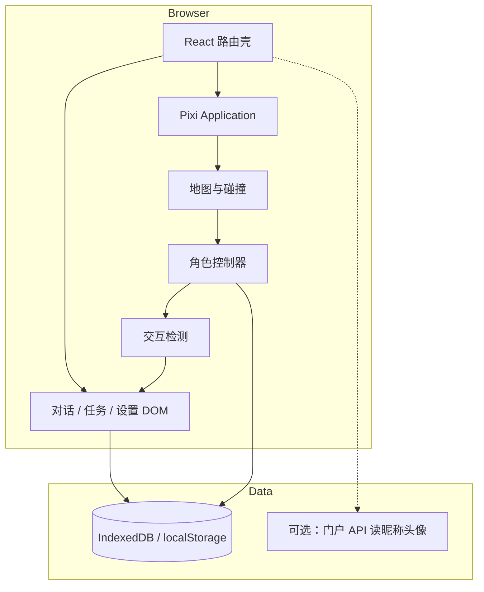

# 小镇创业实训模拟游戏 · 产品需求文档（PRD）

> **技术栈**：PixiJS（2D 渲染）+ PC Web  
> **版本**：V0.1（立项稿）  
> **对齐文档**：[演示系统业务说明](./演示系统业务说明.md)、[系统操作流程导图](./系统操作流程导图.md)、[实训平台项目设计方案](./实训平台项目设计方案.md)

---

## 1. 文档定位

### 1.1 产品是什么

在「大学生创业实训平台」之外，提供一套 **可独立打开的 2D 小镇场景**：学生以可控角色在地图中走动，与 NPC / 队友 / 建筑交互，用 **游戏化空间** 理解并演练与正式实训一致的 **七阶段创业流程**（组队 → 创意 → 调研 → 产品 → 商业模式 → AI 仿真 → 计划书）。

### 1.2 与主平台的关系（核心原则）

| 维度 | 要求 |
|------|------|
| **入口** | **不依赖**「实践课程 / 知识点检测 / 教师阶段解锁」才能进入游戏；拥有平台账号（或沙盒访客策略，见 §4）即可从独立菜单进入。 |
| **流程参照** | 小镇内任务链、建筑分区、术语与产出物 **与正式实训模块一一映射**（见 §6），便于学生「先玩懂再填表」。 |
| **数据** | 默认 **沙盒模式** 下进度以游戏存档为主；与教学班表单的双向同步为 **可选能力**（建议二期），避免阻塞游戏 MVP。 |
| **部署** | 作为 Web 子应用或独立路由包，随现有 `gateway` 静态资源发布；运行环境可与 Docker 沙盒/演示环境一致（见 §11）。 |

### 1.3 不在范围内（V0.1）

- 手机 / 平板触屏适配、竖屏 UI。
- 3D、开放世界大地图、多人在线实时同屏（仅预留架构扩展点）。
- 替代正式实训模块的表单提交与教师审核（游戏内可做「草稿预览」，真提交仍走主平台页面或 API）。

---

## 2. 目标用户与场景

### 2.1 用户

| 角色 | 目标 |
|------|------|
| **学生** | 课前熟悉流程、课后复盘；在沙盒中试错参数（如仿真类玩法）而不污染正式作业。 |
| **教师** | 备课演示：投屏小镇路线讲解七阶段；可选发放「小镇任务清单」与课堂 PPT 对齐。 |
| **访客 / 体验** | 开放日、招生宣传：仅沙盒 + 只读 NPC 讲解（若学校政策允许匿名试玩）。 |

### 2.2 典型场景

1. 学生从首页或学生中心点击 **「创业小镇（沙盒）」**，无需先完成检测题。
2. 在小镇广场选 **单人演练** 或 **导入本班队名/成员昵称（仅展示，可不绑后端）**。
3. 按地图引导依次进入各建筑，完成轻量交互任务（对话、收集、小游戏、填写简表）。
4. 结束时生成 **小镇通关纪要**（本地 JSON / 可导出 PDF 占位），提示「到学生中心对应模块提交正式成果」。

---

## 3. 产品目标与成功指标

### 3.1 目标

1. **可 walk 的 PC 小镇**：角色四向/八向走动、碰撞、镜头跟随，帧率稳定。
2. **可对话的 NPC 体系**：至少覆盖七阶段各 1 名核心 NPC + 1 名导师型 NPC。
3. **流程可对照实训**：任意阶段建筑内 UI 能展示与主平台一致的模块名称与关键产出清单。
4. **沙盒可闭环**：不登录教学班也能完成一轮「迷你七阶段」；登录后可读头像昵称增强代入感。
5. **美术可迭代**：支持大模型生成的 **多视角角色图集** 按规范导入（见 §9）。

### 3.2 验收指标（V0.1）

| 指标 | 标准 |
|------|------|
| 兼容浏览器 | Chrome / Edge 最近两个大版本；分辨率 ≥ 1280×720，推荐 1920×1080 |
| 性能 | 空场景 + 1 主角 + 10 NPC 静态点，1080p 下平均 ≥ 50 FPS（中档办公本） |
| 流程 | 沙盒内 45～90 分钟可完成七阶段引导线（可跳过已读对话） |
| 独立入口 | 从主站路由进入，**不出现**「请先完成实践课程」类阻断（与教学班解锁解耦） |

---

## 4. 沙盒模式定义

### 4.1 模式说明

**沙盒模式**指游戏的默认运行态，具备以下特征：

- **无教师阶段锁**：不读取 `course_settings` 的阶段起止作为硬门禁（若读取，仅用于 UI 提示「课堂当前阶段建议」）。
- **独立存档**：`localStorage` 或 IndexedDB 存档位；支持「新游戏 / 继续 / 重置沙盒」。
- **数据隔离**：仿真数值、对话选择默认 **不写** 组队/计划书等业务表；导出为 `.json` 供学生自行对照填写正式模块。
- **可选课内模式（二期）**：同一引擎，`mode=class` 时带 `classId` + `teamId`，完成任务可深链到 `/student-center?module=xxx` 并预填草稿（需产品单独排期）。

### 4.2 与「Docker / 演示沙盒」的关系

游戏本身无状态，**运行在平台已部署的 Web 沙盒/演示环境**即可：静态资源由 `gateway` 提供，若需调用 AI 对话 NPC，走现有 Node API 网关（需鉴权与限流，与主平台 AI 策略一致）。不要求单独游戏服务器进程。

---

## 5. 世界观与地图设计

### 5.1 世界观一句话

**「创想小镇」**——一所虚构高校旁的创业实训街区，各楼栋对应实训七阶段，镇民（NPC）是导师、投资人、用户代表与队友的化身。

### 5.2 地图分区（建议单张 Tiled 地图，可分区块加载）

| 区域 ID | 场景名 | 对应实训模块 | 核心交互 |
|---------|--------|--------------|----------|
| `plaza` | 中央广场 | 组队 | 组队公告板、邀请队友（昵称）、角色分工卡片 |
| `ideation_cafe` | 灵感咖啡馆 | 创意 | 头脑风暴便签墙、三选一创意卡 |
| `research_lab` | 调研驿站 | 市场调研 | 简版问卷演示、用户画像立牌 |
| `maker_garage` | 造物工坊 | 产品设计 | 功能清单白板、原型热点图（静态） |
| `bmc_tower` | 模式大厦一层 | 商业模式 | 九格画布占位、SWOT 四象限 |
| `sim_center` | 仿真中心 | AI 仿真 / 角色分工 | 轻量参数滑条（用户/收入趋势示意），对接主平台仿真逻辑的 **简化版** |
| `pitch_hall` | 路演厅 | 商业计划书 | 章节清单勾选、导出「计划书提纲」 |
| `dorm_alley` | 宿舍巷（可选） | — | 存档、设置、图鉴 |

### 5.3 地图规模（V0.1）

- 可玩面积约 **80×60 格**（格宽 32px 或 48px，二选一全项目统一）。
- 单场景传送点：广场 ↔ 各建筑门口，避免大地图跑路疲劳。
- **碰撞层**：建筑墙体、水体、装饰；**交互层**：门口触发区、NPC 站位。

---

## 6. 玩法与实训流程映射

### 6.1 主线任务链（参照七阶段，游戏内软引导）

- 玩家可 **自由乱序进入建筑**（沙盒），但任务日志默认按上表推荐顺序勾选。
- 每个阶段完成条件：**关键对话读完 + 1 个互动小游戏或表单最小集提交（存本地）**。

### 6.2 各阶段游戏化交互（最小可行）

| 阶段 | 游戏内最小交互 | 与主平台产出对照 |
|------|----------------|------------------|
| 组队 | 选队长、分配 3 个岗位标签 | 团队分工、队名 |
| 创意 | 从 3 张 AI/预设卡选 1，可改名 | 创意标题与描述 |
| 调研 | 拖动 5 个痛点到画像卡 | Persona 字段 |
| 产品 | 连线「功能-用户故事」3 组 | 功能列表 |
| 商业模式 | 填 9 格中至少 4 格（文本） | BMC |
| 仿真 | 调 3 个参数看 7 日折线动画 | 角色仿真/市场挑战简化 |
| 计划书 | 勾选 7 个章节是否已在小镇完成 | 计划书目录 |

### 6.3 角色交互

- **走近 + 按键交互**（默认 `E` 或 `Space`）：弹出对话 UI（DOM 覆盖层，非 Pixi 内复杂文本排版）。
- **队友 NPC**（可选）：根据组队结果生成 2～4 个静止或巡逻队友，仅对话与表情，无战斗。
- **导师 NPC**：广场常驻，提供「当前推荐去哪栋楼」与术语词典。
- **对话结构**：节点树 + 跳过已读；重要节点写入任务日志。

### 6.4 走动与操作（PC）

| 操作 | 行为 |
|------|------|
| `WASD` / 方向键 | 八向移动（斜向速度归一化） |
| `Shift` | 奔跑（可选，略增移速） |
| `E` / `Space` | 与面前交互物 / NPC 交互 |
| `M` | 打开小镇地图（静态图 + 玩家点） |
| `J` | 任务日志 |
| `Esc` | 暂停 / 设置（音量、重置沙盒、返回主站） |

---

## 7. 角色与美术规范（含大模型多视角）

### 7.1 主角

- 单角色可控；外观 V0.1 可用 **默认皮肤** + 后续换肤。
- **多视角图集**（推荐 4 或 8 方向）：与 Tiled 八向移动一致。

### 7.2 大模型出图规范（供美术 / 生成提示词）

| 项目 | 规范 |
|------|------|
| 画布 | 单帧透明 PNG；角色居中，脚底对齐画布底边中点 |
| 方向 | 至少 **南、西、东、北** 四向；扩展为 **南、西南、西、西北、北、东北、东、东南** |
| 尺寸 | 每帧建议 **64×64** 或 **96×96**（与地图格比例一致） |
| 帧数 | 每方向 **4 帧行走 + 1 帧站立**（V0.1 可仅 1 帧行走循环） |
| 风格 | 统一像素或统一扁平插画；全项目禁止混用多种渲染风格 |
| 命名 | `{roleId}_{dir}_{frame}.png`，图集合并为 `{roleId}.json`（TexturePacker / free-tex-packer） |
| 验收 | 四向站立时 **肩宽、头高、脚点** 偏差 ≤ 2px（人工目视），避免走动时「滑步」感过大 |

### 7.3 NPC 与场景

- NPC 可与主角共用骨骼/图集模板，仅换色与配饰。
- 场景瓦片：Tiled 导出 JSON；对象层标记 `spawn`、`portal`、`npc_*`、`trigger_*`。

---

## 8. 技术方案（PixiJS · PC Web）

### 8.1 技术选型

| 层级 | 选型 | 说明 |
|------|------|------|
| 渲染 | **PixiJS v8** | 2D 瓦片地图、精灵动画、相机 |
| 地图 | **@pixi/tilemap** 或自研 `Tiled` 解析 | 解析 Tiled JSON |
| 物理/碰撞 | **简单 AABB 格点碰撞**（V0.1 不上 Matter.js） | 与性能和解耦 |
| UI | **React 壳 + Pixi Canvas** | 对话、表单、任务日志用 DOM；游戏画面独占 Canvas |
| 状态 | **Zustand** 或现有项目状态方案 | 存档序列化 |
| 构建 | **Vite** | 与 `web`  monorepo 子包 `web-town` 或 `web/src/town-game` |
| 路由 | `/town-sandbox` | 全屏布局，隐藏主站移动端底栏（本游戏不服务手机） |

### 8.2 架构示意

### 8.3 模块划分（代码）

| 模块 | 职责 |
|------|------|
| `TownGameApp` | 初始化 Pixi、resize、销毁 |
| `AssetLoader` | 图集、瓦片、进度条 |
| `SceneManager` | 场景切换、淡入淡出 |
| `PlayerController` | 输入、移动、动画状态机 |
| `InteractionSystem` | 面向检测、触发对话 ID |
| `QuestSystem` | 七阶段任务状态机 |
| `SandboxSave` | 存档读写、版本迁移 |
| `Bridge` | 返回主站、深链到实训模块（二期） |

### 8.4 PC 端约束

- **最低宽度 1280px**；小于该宽度显示「请使用 PC 浏览器全屏」占位页，不提供虚拟摇杆。
- 禁止依赖 `touchstart` 作为唯一输入。
- 音频默认静音，用户点击后再播放 BGM（浏览器策略）。

---

## 9. 信息架构与入口

### 9.1 主站入口（与必修解耦）

- 首页 / 学生中心增加 **「创业小镇 · 沙盒」** 按钮，路由直达 `/town-sandbox`。
- **不校验** 实践课程完成率；**不校验** 教师是否开放某 `module`。
- 登录态：有 token 则显示学生昵称；无 token 时策略二选一（产品定稿）：
  - **A**：允许匿名沙盒，存档仅本机；
  - **B**：要求登录但不校验课程（推荐，与学校账号体系一致）。

### 9.2 游戏内 IA

- 顶栏（DOM）：小镇名、沙盒标签、任务进度 `3/7`、返回主站。
- 侧栏（可折叠）：阶段列表，点击仅 **导航提示**，不强制传送（或消耗「校车券」传送，二期）。

---

## 10. 内容与配置

### 10.1 可配置表（JSON / 后台二期）

- `npc_dialogues.json`：对话树
- `quests.json`：阶段目标与完成条件
- `buildings.json`：建筑与场景映射
- `glossary.json`：与 [演示系统业务说明](./演示系统业务说明.md) 术语一致

### 10.2 本地化

- V0.1 仅简体中文；文案 key 预留 `i18n`。

---

## 11. 非功能需求

| 类别 | 要求 |
|------|------|
| 性能 | 纹理合图；单场景 draw call 可控；离屏建筑不更新 |
| 安全 | 沙盒存档不上传敏感隐私；若同步 API，走现有 JWT |
| 可访问性 | 对话支持键盘选择选项；字幕字号可调（PC） |
| 运维 | 静态资源 CDN/网关缓存；版本号写入存档兼容字段 `saveVersion` |
| 日志 | 前端埋点：进入沙盒、阶段完成、退出（可选接现有运营日志） |

---

## 12. 版本规划

### 12.1 MVP（V0.1）

- 单地图 + 七建筑可进入（室内可用简化单屏代替第二张子地图）
- 1 主角八向走 + 碰撞
- 7 阶段各 1 条任务线 + 导师 NPC
- 沙盒存档 / 重置
- 独立路由入口，与课程解锁解耦

### 12.2 V0.2

- 室内子场景、队友 NPC 巡逻
- 仿真中心与主平台 `role-simulation` 只读拉取团队配置（若已组队）
- 教师投屏「仅观看」模式（隐藏操作栏，键盘由演示者控制）

### 12.3 V0.3

- `mode=class` 存档同步与草稿深链
- 小镇任务完成度在学生中心进度看板 **只读展示**（徽章）

---

## 13. 风险与依赖

| 风险 | 缓解 |
|------|------|
| 大模型角色多视角不一致 | 固定提示词模板 + 人工修脚点 + 四向先行 |
| Pixi 与 React 同屏性能 | 限制 DOM 重绘；对话时可选暂停游戏循环 |
| 与实训「双轨」造成学生混淆 | 建筑内常驻「去正式模块提交」按钮与说明 |
| 范围膨胀 | V0.1 室内用 UI 面板代替第二张大地图 |

---

## 14. 附录

### 14.1 名词对照

| 游戏 | 实训平台 |
|------|----------|
| 创想小镇 | 创业实训全流程 |
| 沙盒存档 | 与教学班作业隔离的本地演练 |
| 仿真中心 | AI 仿真 / 角色推荐 / 市场挑战（简化） |
| 路演厅 | 商业计划书 |

### 14.2 参考路由（主平台）

| 实训模块 | 主站路由（深链用） |
|----------|-------------------|
| 组队 | `/team-formation` |
| 创意 | `/ideation` |
| 调研 | `/market-research` |
| 产品 | `/product-design` |
| 商业模式 | `/business-model` |
| AI 仿真 | `/role-simulation` |
| 计划书 | `/business-plan` |

### 14.3 文档维护

- 七阶段若有平台侧改名，同步更新 §5.2、§6、§14.1。
- 沙盒与课内同步策略定稿后，更新 §4 与 §12.3。

---

*PRD V0.1 · 小镇创业实训模拟（PixiJS / PC Web / 沙盒模式）*
