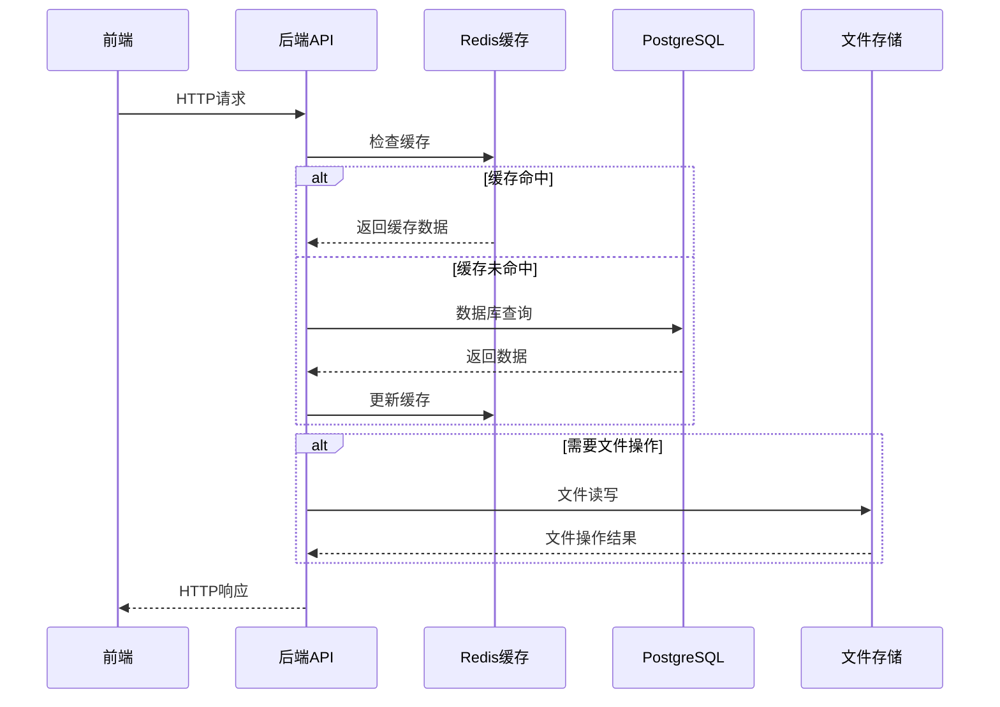

# 创新创业实训平台项目设计文档

## 1. 文档说明

本文档用于定义创新创业实训平台的整体设计方案，面向前端、后端、测试与运维协同实施。  
文档聚焦系统架构、数据设计、接口规范、缓存策略与部署方案，不包含具体代码实现细节。

### 1.1 版本状态与适用范围

- 本文档以 `1-12` 章节为当前权威版本，作为开发、测试、上线验收的统一依据。
- 文档后续“历史草案”内容仅用于保留设计演进过程，不作为当前实现基线。
- 若两处描述存在冲突，以当前权威版本章节为准，并在变更时同步更新相关章节。

## 2. 项目目标与范围

### 2.1 项目目标

- 建设一套支持教学管理与实训协作的一体化平台。
- 支持学生、教师、管理员三类角色的高效协作。
- 通过 PostgreSQL + Redis 保证业务一致性与访问性能。
- 通过容器化部署保障可复制交付与稳定运行。

### 2.2 业务范围

1. 用户管理：账号、角色、状态、导入与权限控制。  
2. 班级管理：班级维护、学生分配、教师关联。  
3. 课程与资源管理：课程、知识点、案例资源的创建、审核与发布。  
4. 任务管理：任务发布、附件管理、截止时间控制。  
5. 团队协作：组队、成员管理、团队提交。  
6. 统计分析：用户、课程、任务、学习行为数据统计。

## 3. 总体技术架构

### 3.1 技术栈

| 分类 | 技术 |
|------|------|
| 前端 | 现有前端工程（保持兼容） |
| 后端 | Node.js + Express |
| 数据库 | PostgreSQL 15+ |
| 缓存 | Redis 7+ |
| 认证 | JWT |
| 部署 | Docker / Docker Compose |

### 3.2 架构分层

- 接入层：前端页面与 API 网关入口。
- 应用层：认证、用户、班级、课程、任务、团队、统计等业务域。
- 数据层：PostgreSQL 承载事务与核心业务数据。
- 缓存层：Redis 承载热点读取、会话状态与短周期统计结果。
- 运维层：容器编排、健康检查、日志采集、监控告警。

### 3.3 核心交互流程

1. 前端请求进入后端 API。  
2. 后端先查询 Redis 缓存；命中则直接返回。  
3. 未命中则访问 PostgreSQL 并回写缓存。  
4. 写请求先落库，再执行缓存失效或延迟双删策略。  
5. 统一返回标准化响应与可追踪日志字段（如 traceId）。

#### 系统交互时序图



## 4. 模块设计

### 4.1 用户与权限

- 支持 student / teacher / admin 三角色。
- 基于 JWT 的鉴权机制与接口级权限控制。
- 账号状态控制（启用/禁用）和安全审计日志。

### 4.2 教学组织

- 班级与教师建立关联。
- 学生与班级建立归属关系。
- 支持组织结构扩展（学院、专业、学期维度）。

### 4.3 教学资源

- 课程信息管理与审核流转。
- 知识点与案例资源维护，支持标签化检索。
- 资源状态分层（草稿、待审、发布、下线）。

### 4.4 任务与团队

- 任务发布、截止时间与状态流转。
- 团队创建、成员管理、任务提交与评阅反馈。
- 附件上传策略与文件元数据管理。

### 4.5 统计分析

- 用户统计、课程统计、任务统计、学习行为统计。
- 支持按班级/课程/时间区间聚合分析。
- 统计接口可通过缓存提升读取性能。

## 5. 数据库设计

### 5.1 核心实体

- 用户：`users`
- 班级：`classes`
- 课程：`courses`
- 知识点：`knowledge_points`
- 案例：`cases`
- 任务：`tasks`
- 任务附件：`task_attachments`
- 团队：`teams`
- 团队成员：`team_members`
- 任务提交：`task_submissions`
- 提交附件：`submission_attachments`

### 5.2 关系说明

- 一个班级可关联一个教师与多个学生。
- 一个课程可关联多个知识点和案例。
- 一个任务可关联多个附件与多个提交记录。
- 一个团队可包含多个成员，并对应多个任务提交。

### 5.3 数据一致性原则

- 关键外键完整性在数据库层强约束。
- 高频查询字段建立索引（如用户角色、课程状态、任务截止时间）。
- 审核和状态流转字段保留时间戳，便于追踪与审计。

### 5.4 写库与缓存一致性闭环

- 写请求采用“数据库事务提交成功 -> 发布缓存失效任务”的顺序，禁止先删缓存后写库。
- 缓存失效任务失败时进行指数退避重试（建议最多 5 次）；超过阈值进入死信队列并触发告警。
- 同一业务主键的失效任务按 Key 串行处理，避免并发重试导致旧值覆盖新值。
- 读路径允许最终一致窗口（建议不超过 2 秒）；超过窗口仍未一致时记录错误日志并上报告警。

## 6. API 设计规范

### 6.1 接口分组

- 认证接口：登录、刷新、登出、密码管理。
- 用户接口：用户增删改查、批量导入。
- 班级接口：班级管理、学生分配。
- 课程与资源接口：课程、知识点、案例、审核。
- 任务与团队接口：任务发布、团队管理、提交与评阅。
- 统计接口：多维度聚合查询。

### 6.2 统一约定

- 统一前缀：`/api`
- 响应格式统一：`code`、`message`、`data`、`traceId`
- 错误分级：参数错误、权限错误、资源不存在、系统异常
- 幂等设计：重复提交场景需支持幂等键

统一响应示例：
```json
{
  "code": 0,
  "message": "OK",
  "data": {
    "id": 1
  },
  "traceId": "a1b2c3d4"
}
```

### 6.3 接口契约补充规则

- 版本策略：当前统一使用 `v1` 语义版本，路径保持 `/api`，重大不兼容变更时新增 `/api/v2`。
- 分页参数：`page`、`pageSize`、`sortBy`、`order`、`filters`；分页返回至少包含 `items`、`total`、`page`、`pageSize`。
- 错误码字典：需覆盖 `AUTH_REQUIRED`、`PERMISSION_DENIED`、`PARAM_INVALID`、`RESOURCE_NOT_FOUND`、`CONFLICT`、`RATE_LIMITED`、`INTERNAL_ERROR`。
- 幂等约定：创建/提交类接口强制 `Idempotency-Key`；服务端按 `(operatorId, apiPath, key)` 去重并保留 24 小时。

### 6.4 API 到后端分层实现映射

| API 分组 | Route | Controller | Service | 主要 Model |
|---------|-------|------------|---------|-----------|
| 认证相关 | `routes/auth.js` | `controllers/auth.js` | `services/authService.js` | `User` |
| 用户管理 | `routes/user.js` | `controllers/user.js` | `services/userService.js` | `User` |
| 班级管理 | `routes/class.js` | `controllers/class.js` | `services/classService.js` | `Class`, `User` |
| 课程管理 | `routes/course.js` | `controllers/course.js` | `services/courseService.js` | `Course`, `KnowledgePoint`, `Case` |
| 资源管理 | `routes/resource.js` | `controllers/resource.js` | `services/resourceService.js` | `KnowledgePoint`, `Case` |
| 任务管理 | `routes/task.js` | `controllers/task.js` | `services/taskService.js` | `Task`, `TaskAttachment` |
| 团队管理 | `routes/team.js` | `controllers/team.js` | `services/teamService.js` | `Team`, `TeamMember` |
| 任务提交 | `routes/submission.js` | `controllers/submission.js` | `services/submissionService.js` | `TaskSubmission`, `SubmissionAttachment` |
| 统计分析 | `routes/statistic.js` | `controllers/statistic.js` | `services/statisticService.js` | 多表聚合只读模型 |

## 7. Redis 缓存设计

| 缓存键示例 | 用途 | 建议过期时间 |
|-----------|------|-------------|
| `user:{id}` | 用户信息 | 1 小时 |
| `class:{id}` | 班级详情 | 1 小时 |
| `course:{id}` | 课程详情 | 1 小时 |
| `tasks:class:{classId}` | 班级任务列表 | 30 分钟 |
| `resources:knowledge:latest` | 最新知识点 | 2 小时 |
| `resources:cases:recommended` | 推荐案例 | 2 小时 |
| `statistics:*` | 统计聚合结果 | 10 分钟 |

缓存策略：
- 读多写少数据优先缓存。
- 写操作触发精确失效，避免脏数据长期停留。
- 大 Key 和热点 Key 纳入监控阈值。
- 防穿透：不存在对象可使用短 TTL 空值缓存，必要时结合布隆过滤器。
- 防击穿：热点 Key 重建采用互斥锁或逻辑过期 + 异步刷新。
- 防雪崩：TTL 增加随机抖动，避免同批 Key 同时过期。
- 统计类缓存（`statistics:*`）采用短 TTL + 异步重算，避免强一致带来的写放大。

## 8. Docker 部署逻辑（保留）

### 8.1 容器组成

- `backend`：Node.js API 服务
- `postgres`：业务数据库
- `redis`：缓存与会话状态

### 8.2 编排原则

- 使用 `docker-compose` 统一编排应用与依赖。
- 服务间通过 Compose 网络互联，避免硬编码主机地址。
- `backend` 依赖 `postgres` 与 `redis` 启动顺序。
- 配置通过环境变量注入，避免将敏感信息写入镜像。

### 8.3 镜像与运行建议

- 后端镜像基于轻量 Node 版本构建。
- 生产环境仅安装运行时依赖，降低镜像体积与攻击面。
- 暴露业务端口（示例 3000），按环境映射宿主机端口。
- 数据持久化使用 Volume，保障数据库与缓存持久目录可管理。

### 8.4 健康检查与重启策略

- 后端提供健康检查接口（如 `/health`）。
- Compose 配置健康检查探针与自动重启策略（`unless-stopped`）。
- 依赖服务异常时，后端应具备重连与降级处理能力。

### 8.5 1000 并发下的部署建议

- API 服务实例数建议至少 2 个，可按压测结果水平扩容。
- 在入口层增加反向代理（Nginx/网关）进行负载均衡。
- PostgreSQL 连接池与 Redis 连接数需按并发上限预留。
- 对统计与列表类接口启用缓存与分页，降低数据库压力。
- 容量估算建议基线：`QPS = 并发用户数 * 人均请求频率`，并按读写比例拆分数据库与缓存预算。
- 连接池预算建议：按“单实例最大连接数 * 实例数 + 维护预留连接”控制 PostgreSQL 总连接上限。
- Redis 需设置内存上限和淘汰策略（如 `allkeys-lru`），并对热点 Key 进行预热与监控。

### 8.6 灾备与恢复目标

- 恢复目标建议：`RPO <= 15 分钟`，`RTO <= 60 分钟`。
- PostgreSQL 采用“每日全量备份 + WAL 持续归档”策略，确保可按时间点恢复。
- Redis 根据业务级别选择 AOF/RDB 组合，并定期校验备份可用性。
- 每月至少执行一次恢复演练，记录恢复耗时、数据丢失窗口与遗留问题。

## 9. 安全与可观测性

### 9.1 安全要求

- JWT 密钥、数据库密码等统一由环境变量管理。
- 输入参数白名单校验，防止注入与越权访问。
- 上传文件类型、大小、命名策略进行安全控制。
- Access Token 建议短时效（如 15 分钟），Refresh Token 建议 7 天并启用轮换机制。
- 支持 Token 吊销与强制下线（如密码变更后使历史 Token 失效）。
- JWT 密钥应支持定期轮换，避免长期固定密钥带来的风险。
- 上传链路需增加 MIME 校验与恶意文件隔离，下载接口必须执行资源归属鉴权。

### 9.2 日志与监控

- 统一结构化日志：时间、级别、模块、traceId、耗时、错误码。
- 关键指标监控：请求量、错误率、接口耗时、数据库慢查询、Redis 命中率。
- 告警策略：错误率、延迟、连接池耗尽、容器重启频次异常。
- 观测基线建议：可用性、P95/P99 延迟、5xx 错误率、数据库连接池使用率、Redis 内存水位。
- SLO 示例：核心接口可用性 >= 99.9%，核心读接口 P95 <= 300ms，5xx <= 0.1%。
- 告警阈值示例：5xx 超过 1% 且持续 5 分钟、P95 超过 500ms 且持续 10 分钟触发告警。

## 10. 测试策略

- 功能测试：覆盖核心业务主流程与异常分支。
- 接口测试：覆盖鉴权、权限、分页、状态流转、幂等场景。
- 压力测试：以 1000 并发为目标验证系统稳定性与容量边界。
- 回归测试：每次迭代执行自动化回归，确保核心功能不回退。
- 契约测试：基于统一接口契约校验响应结构与错误码语义。
- 一致性测试：覆盖“写库成功/缓存失效失败”“并发写入乱序”等关键竞态场景。

## 11. AI 生成代码验收与交付标准 

### 11.1 交付物清单

1. 可运行源码（前后端及配置文件）。  
2. 数据库初始化脚本与必要迁移说明。  
3. Docker 部署文件（含 Compose 编排）。  
4. API 文档与测试用例说明。  
5. 压测报告与监控指标截图/导出。  
6. 上线与回滚操作说明。

### 11.2 功能验收标准

- 需求范围内功能点完成度 100%。  
- 关键业务流程（登录、课程管理、任务发布、任务提交、统计查询）可端到端通过。  
- 权限模型正确：不同角色访问边界准确，无越权接口。

### 11.3 性能验收标准 

压测条件建议：
- 并发用户：1000
- 持续压测时长：30 分钟
- 数据规模：接近真实业务量级（至少万级记录）

指标标准：

| 指标项 | 验收标准 |
|-------|----------|
| 平均响应时间（核心读接口） | <= 200 ms |
| P95 响应时间（核心读接口） | <= 300 ms |
| P99 响应时间（核心读接口） | <= 600 ms |
| 平均响应时间（核心写接口） | <= 400 ms |
| 错误率（5xx） | <= 0.1% |
| 成功率 | >= 99.9% |
| 容器可用性 | 压测期间无不可恢复故障 |

### 11.4 稳定性与可运维验收标准

- 服务连续运行 72 小时无内存泄漏和异常退出。  
- 异常场景具备清晰错误日志与可追踪链路。  
- 部署、扩容、回滚操作可在文档指导下独立完成。  
- 监控与告警可及时发现性能下降与依赖故障。

### 11.5 代码质量验收标准

- 目录结构清晰，模块职责明确，避免耦合堆叠。  
- 关键逻辑具备必要注释与错误处理。  
- 无硬编码敏感信息。  
- 接口、数据库、缓存、部署文档保持一致。

### 11.6 CI/CD 与发布门禁标准

- 流水线必须包含：单元测试、接口测试、数据库迁移检查、依赖安全扫描、镜像安全扫描。
- 合并门禁建议：核心模块测试通过且覆盖率达到约定阈值（建议不低于 80%）。
- 发布策略建议：灰度发布（10% -> 50% -> 100%）并在每阶段观察关键指标。
- 回滚触发条件：错误率或延迟超过阈值时自动回滚到上一稳定版本。

## 12. 结论

该方案在保持现有前端兼容的前提下，定义了 Node.js + PostgreSQL + Redis 的可落地架构，并通过 Docker 形成标准化部署路径。  
通过补充 AI 生成代码的验收与交付标准，项目可在功能完整、性能可量化（1000 并发）、运维可执行的条件下交付上线。
 
 

# 附录 A：历史草案（仅参考，不作为当前实现基线）

## 需求分析

通过分析前端项目结构，我发现这是一个创新创业实训平台，主要功能模块包括：

1. **用户管理**：包含学生、教师、管理员三种角色，支持用户CRUD操作、批量导入、密码重置等功能
2. **班级管理**：支持班级创建、编辑、删除，以及学生分配
3. **课程资源管理**：包含课程、知识点、案例库等教学资源的管理和审核
4. **任务管理**：教师发布任务，学生提交作业，支持附件上传
5. **团队管理**：学生组队功能，团队作业提交与评审
6. **统计分析**：学习数据统计、用户活跃度分析等

## 技术方案

### 技术栈选择

| 分类 | 技术 | 版本 | 选型理由 |
|------|------|------|----------|
| 后端框架 | Express.js | ^4.18.2 | 轻量高效的Node.js框架，生态成熟，适合构建RESTful API |
| 数据库 | PostgreSQL | 15.0 | 功能强大的开源关系型数据库，支持复杂查询和JSON数据类型，适合教育平台的数据存储需求 |
| 缓存 | Redis | 7.0+ | 用于缓存热点数据、管理Session/Token，提高系统性能 |
| 认证 | JWT | - | 无状态认证，便于水平扩展，适合前后端分离架构 |
| ORM | Sequelize | ^6.35.0 | 功能强大的Node.js ORM库，支持PostgreSQL，简化数据库操作 |
| 文件存储 | Multer + 本地存储 | - | 处理文件上传，适合中小型应用 |
| 日志 | Winston | ^3.11.0 | 灵活的日志管理工具，支持多传输目标 |
| 测试 | Jest | ^29.7.0 | 流行的JavaScript测试框架，适合API测试 |

### 架构设计

 
#### 目录结构

```
backend/
├── config/           # 配置文件
│   ├── database.js   # 数据库配置
│   ├── redis.js      # Redis配置
│   └── server.js     # 服务器配置
├── controllers/      # 控制器
│   ├── auth.js       # 认证相关
│   ├── user.js       # 用户管理
│   ├── class.js      # 班级管理
│   ├── course.js     # 课程管理
│   ├── task.js       # 任务管理
│   ├── resource.js   # 资源管理
│   ├── team.js       # 团队管理
│   ├── submission.js # 任务提交
│   └── statistic.js  # 统计分析
├── middlewares/      # 中间件
│   ├── auth.js       # 认证中间件
│   ├── error.js      # 错误处理
│   └── logger.js     # 日志中间件
├── models/           # 数据模型
│   ├── User.js       # 用户模型
│   ├── Class.js      # 班级模型
│   ├── Course.js     # 课程模型
│   ├── KnowledgePoint.js # 知识点模型
│   ├── Case.js       # 案例模型
│   ├── Task.js       # 任务模型
│   ├── TaskAttachment.js   # 任务附件模型
│   ├── Team.js       # 团队模型
│   ├── TeamMember.js # 团队成员模型
│   ├── TaskSubmission.js   # 任务提交模型
│   └── SubmissionAttachment.js # 提交附件模型
├── routes/           # 路由
│   ├── auth.js       # 认证路由
│   ├── user.js       # 用户路由
│   ├── class.js      # 班级路由
│   ├── course.js     # 课程路由
│   ├── task.js       # 任务路由
│   ├── resource.js   # 资源路由
│   ├── team.js       # 团队路由
│   ├── submission.js # 提交路由
│   └── statistic.js  # 统计路由
├── services/         # 业务逻辑
│   ├── authService.js    # 认证服务
│   ├── userService.js    # 用户服务
│   ├── classService.js   # 班级服务
│   ├── courseService.js  # 课程服务
│   ├── taskService.js    # 任务服务
│   ├── resourceService.js # 资源服务
│   ├── teamService.js    # 团队服务
│   ├── submissionService.js # 提交服务
│   └── statisticService.js # 统计服务
├── utils/            # 工具函数
│   ├── jwt.js        # JWT工具
│   ├── password.js   # 密码处理
│   └── validator.js  # 数据验证
├── uploads/          # 上传文件存储
├── app.js            # 应用入口
├── server.js         # 服务器启动
├── package.json      # 依赖管理
└── .env.example      # 环境变量示例
```

### 数据库设计

#### 1. 用户表 (`users`)

| 字段名 | 数据类型 | 约束 | 描述 |
|--------|----------|------|------|
| `id` | `SERIAL` | `PRIMARY KEY` | 用户ID |
| `name` | `VARCHAR(100)` | `NOT NULL` | 姓名 |
| `email` | `VARCHAR(255)` | `UNIQUE NOT NULL` | 邮箱 |
| `password` | `VARCHAR(255)` | `NOT NULL` | 密码哈希 |
| `role` | `VARCHAR(20)` | `NOT NULL` | 角色(student/teacher/admin) |
| `status` | `VARCHAR(20)` | `NOT NULL DEFAULT 'active'` | 状态(active/inactive) |
| `department` | `VARCHAR(100)` | `NOT NULL` | 部门/学院 |
| `student_id` | `VARCHAR(50)` | `UNIQUE` | 学号(学生) |
| `employee_id` | `VARCHAR(50)` | `UNIQUE` | 工号(教师/管理员) |
| `class_id` | `INTEGER` | `REFERENCES classes(id)` | 班级ID(学生) |
| `last_login` | `TIMESTAMP` | | 最后登录时间 |
| `created_at` | `TIMESTAMP` | `DEFAULT CURRENT_TIMESTAMP` | 创建时间 |
| `updated_at` | `TIMESTAMP` | `DEFAULT CURRENT_TIMESTAMP` | 更新时间 |

#### 2. 班级表 (`classes`)

| 字段名 | 数据类型 | 约束 | 描述 |
|--------|----------|------|------|
| `id` | `SERIAL` | `PRIMARY KEY` | 班级ID |
| `name` | `VARCHAR(100)` | `NOT NULL` | 班级名称 |
| `department` | `VARCHAR(100)` | `NOT NULL` | 所属部门 |
| `academic_year` | `VARCHAR(20)` | `NOT NULL` | 学年 |
| `semester` | `VARCHAR(20)` | `NOT NULL` | 学期 |
| `teacher_id` | `INTEGER` | `REFERENCES users(id)` | 教师ID |
| `status` | `VARCHAR(20)` | `NOT NULL DEFAULT 'active'` | 状态 |
| `created_at` | `TIMESTAMP` | `DEFAULT CURRENT_TIMESTAMP` | 创建时间 |
| `updated_at` | `TIMESTAMP` | `DEFAULT CURRENT_TIMESTAMP` | 更新时间 |

#### 3. 课程表 (`courses`)

| 字段名 | 数据类型 | 约束 | 描述 |
|--------|----------|------|------|
| `id` | `SERIAL` | `PRIMARY KEY` | 课程ID |
| `name` | `VARCHAR(200)` | `NOT NULL` | 课程名称 |
| `description` | `TEXT` | | 课程描述 |
| `teacher_id` | `INTEGER` | `REFERENCES users(id)` | 教师ID |
| `department` | `VARCHAR(100)` | `NOT NULL` | 所属部门 |
| `status` | `VARCHAR(20)` | `NOT NULL DEFAULT 'pending'` | 状态(pending/approved/rejected/offline) |
| `reject_reason` | `TEXT` | | 驳回原因 |
| `student_count` | `INTEGER` | `DEFAULT 0` | 学生数量 |
| `modules` | `INTEGER` | `DEFAULT 0` | 模块数量 |
| `knowledge_points` | `INTEGER` | `DEFAULT 0` | 知识点数量 |
| `tags` | `JSONB` | | 标签(数组) |
| `created_at` | `TIMESTAMP` | `DEFAULT CURRENT_TIMESTAMP` | 创建时间 |
| `updated_at` | `TIMESTAMP` | `DEFAULT CURRENT_TIMESTAMP` | 更新时间 |

#### 4. 知识点表 (`knowledge_points`)

| 字段名 | 数据类型 | 约束 | 描述 |
|--------|----------|------|------|
| `id` | `SERIAL` | `PRIMARY KEY` | 知识点ID |
| `title` | `VARCHAR(200)` | `NOT NULL` | 标题 |
| `description` | `TEXT` | | 描述 |
| `module` | `VARCHAR(100)` | `NOT NULL` | 所属模块 |
| `type` | `VARCHAR(50)` | `NOT NULL` | 类型(video/document/graphic) |
| `ability_point` | `VARCHAR(100)` | | 能力点 |
| `duration` | `VARCHAR(50)` | | 时长 |
| `views` | `INTEGER` | `DEFAULT 0` | 浏览量 |
| `status` | `VARCHAR(20)` | `NOT NULL DEFAULT 'draft'` | 状态(draft/published) |
| `uploader_id` | `INTEGER` | `REFERENCES users(id)` | 上传者ID |
| `is_public` | `BOOLEAN` | `DEFAULT false` | 是否公开 |
| `created_at` | `TIMESTAMP` | `DEFAULT CURRENT_TIMESTAMP` | 创建时间 |
| `updated_at` | `TIMESTAMP` | `DEFAULT CURRENT_TIMESTAMP` | 更新时间 |

#### 5. 案例表 (`cases`)

| 字段名 | 数据类型 | 约束 | 描述 |
|--------|----------|------|------|
| `id` | `SERIAL` | `PRIMARY KEY` | 案例ID |
| `title` | `VARCHAR(200)` | `NOT NULL` | 标题 |
| `description` | `TEXT` | | 描述 |
| `industry` | `VARCHAR(100)` | | 行业 |
| `case_type` | `VARCHAR(50)` | `NOT NULL` | 类型(success/failure) |
| `module` | `VARCHAR(100)` | `NOT NULL` | 所属模块 |
| `knowledge_points` | `JSONB` | | 相关知识点(数组) |
| `ability_points` | `JSONB` | | 相关能力点(数组) |
| `views` | `INTEGER` | `DEFAULT 0` | 浏览量 |
| `status` | `VARCHAR(20)` | `NOT NULL DEFAULT 'draft'` | 状态(draft/published) |
| `uploader_id` | `INTEGER` | `REFERENCES users(id)` | 上传者ID |
| `is_recommended` | `BOOLEAN` | `DEFAULT false` | 是否推荐 |
| `created_at` | `TIMESTAMP` | `DEFAULT CURRENT_TIMESTAMP` | 创建时间 |
| `updated_at` | `TIMESTAMP` | `DEFAULT CURRENT_TIMESTAMP` | 更新时间 |

#### 6. 任务表 (`tasks`)

| 字段名 | 数据类型 | 约束 | 描述 |
|--------|----------|------|------|
| `id` | `SERIAL` | `PRIMARY KEY` | 任务ID |
| `title` | `VARCHAR(200)` | `NOT NULL` | 标题 |
| `description` | `TEXT` | | 描述 |
| `module` | `VARCHAR(100)` | `NOT NULL` | 所属模块 |
| `deadline` | `DATE` | `NOT NULL` | 截止日期 |
| `scope` | `VARCHAR(20)` | `NOT NULL` | 范围(all/specific) |
| `status` | `VARCHAR(20)` | `NOT NULL DEFAULT 'draft'` | 状态(draft/published/expired) |
| `published_by` | `INTEGER` | `REFERENCES users(id)` | 发布者ID |
| `published_at` | `TIMESTAMP` | | 发布时间 |
| `created_at` | `TIMESTAMP` | `DEFAULT CURRENT_TIMESTAMP` | 创建时间 |
| `updated_at` | `TIMESTAMP` | `DEFAULT CURRENT_TIMESTAMP` | 更新时间 |

#### 7. 任务附件表 (`task_attachments`)

| 字段名 | 数据类型 | 约束 | 描述 |
|--------|----------|------|------|
| `id` | `SERIAL` | `PRIMARY KEY` | 附件ID |
| `task_id` | `INTEGER` | `REFERENCES tasks(id)` | 任务ID |
| `name` | `VARCHAR(255)` | `NOT NULL` | 文件名 |
| `path` | `VARCHAR(255)` | `NOT NULL` | 文件路径 |
| `size` | `VARCHAR(50)` | | 文件大小 |
| `created_at` | `TIMESTAMP` | `DEFAULT CURRENT_TIMESTAMP` | 创建时间 |

#### 8. 团队表 (`teams`)

| 字段名 | 数据类型 | 约束 | 描述 |
|--------|----------|------|------|
| `id` | `SERIAL` | `PRIMARY KEY` | 团队ID |
| `name` | `VARCHAR(100)` | `NOT NULL` | 团队名称 |
| `class_id` | `INTEGER` | `REFERENCES classes(id)` | 班级ID |
| `created_at` | `TIMESTAMP` | `DEFAULT CURRENT_TIMESTAMP` | 创建时间 |
| `updated_at` | `TIMESTAMP` | `DEFAULT CURRENT_TIMESTAMP` | 更新时间 |

#### 9. 团队成员表 (`team_members`)

| 字段名 | 数据类型 | 约束 | 描述 |
|--------|----------|------|------|
| `id` | `SERIAL` | `PRIMARY KEY` | 成员ID |
| `team_id` | `INTEGER` | `REFERENCES teams(id)` | 团队ID |
| `user_id` | `INTEGER` | `REFERENCES users(id)` | 用户ID |
| `role` | `VARCHAR(50)` | | 角色 |
| `created_at` | `TIMESTAMP` | `DEFAULT CURRENT_TIMESTAMP` | 创建时间 |

#### 10. 任务提交表 (`task_submissions`)

| 字段名 | 数据类型 | 约束 | 描述 |
|--------|----------|------|------|
| `id` | `SERIAL` | `PRIMARY KEY` | 提交ID |
| `task_id` | `INTEGER` | `REFERENCES tasks(id)` | 任务ID |
| `team_id` | `INTEGER` | `REFERENCES teams(id)` | 团队ID |
| `submitter_id` | `INTEGER` | `REFERENCES users(id)` | 提交者ID |
| `content` | `TEXT` | | 提交内容 |
| `status` | `VARCHAR(20)` | `NOT NULL DEFAULT 'submitted'` | 状态(submitted/graded) |
| `grade` | `DECIMAL(5,2)` | | 评分 |
| `feedback` | `TEXT` | | 反馈 |
| `submitted_at` | `TIMESTAMP` | `DEFAULT CURRENT_TIMESTAMP` | 提交时间 |
| `graded_at` | `TIMESTAMP` | | 评分时间 |
| `created_at` | `TIMESTAMP` | `DEFAULT CURRENT_TIMESTAMP` | 创建时间 |

#### 11. 提交附件表 (`submission_attachments`)

| 字段名 | 数据类型 | 约束 | 描述 |
|--------|----------|------|------|
| `id` | `SERIAL` | `PRIMARY KEY` | 附件ID |
| `submission_id` | `INTEGER` | `REFERENCES task_submissions(id)` | 提交ID |
| `name` | `VARCHAR(255)` | `NOT NULL` | 文件名 |
| `path` | `VARCHAR(255)` | `NOT NULL` | 文件路径 |
| `size` | `VARCHAR(50)` | | 文件大小 |
| `created_at` | `TIMESTAMP` | `DEFAULT CURRENT_TIMESTAMP` | 创建时间 |

### API设计

> 说明：本附录中的成功响应示例为字段简写，实际联调返回结构以“统一约定”中的 `code/message/data/traceId` 包装格式为准。

#### 1. 认证相关

| API路径 | 方法 | 模块/文件 | 类型 | 功能描述 | 请求体 (JSON) | 成功响应 (200 OK) |
|---------|------|-----------|------|----------|--------------|-------------------|
| `/api/auth/login` | `POST` | `routes/auth.js` | `Router` | 用户登录 | `{"email": "user@example.com", "password": "password123"}` | `{"token": "jwt_token", "user": {...}}` |
| `/api/auth/refresh` | `POST` | `routes/auth.js` | `Router` | 刷新Token | `{"refreshToken": "refresh_token"}` | `{"token": "new_jwt_token"}` |
| `/api/auth/reset-password` | `POST` | `routes/auth.js` | `Router` | 重置密码 | `{"email": "user@example.com"}` | `{"message": "密码重置链接已发送"}` |
| `/api/auth/change-password` | `POST` | `routes/auth.js` | `Router` | 修改密码 | `{"oldPassword": "old123", "newPassword": "new123"}` | `{"message": "密码修改成功"}` |

#### 2. 用户管理

| API路径 | 方法 | 模块/文件 | 类型 | 功能描述 | 请求体 (JSON) | 成功响应 (200 OK) |
|---------|------|-----------|------|----------|--------------|-------------------|
| `/api/users` | `GET` | `routes/user.js` | `Router` | 获取用户列表 | N/A | `[{"id": 1, "name": "张三", ...}]` |
| `/api/users` | `POST` | `routes/user.js` | `Router` | 创建用户 | `{"name": "张三", "email": "zhangsan@example.com", ...}` | `{"id": 1, "name": "张三", ...}` |
| `/api/users/:id` | `GET` | `routes/user.js` | `Router` | 获取用户详情 | N/A | `{"id": 1, "name": "张三", ...}` |
| `/api/users/:id` | `PUT` | `routes/user.js` | `Router` | 更新用户信息 | `{"name": "张三", "email": "zhangsan@example.com", ...}` | `{"id": 1, "name": "张三", ...}` |
| `/api/users/:id` | `DELETE` | `routes/user.js` | `Router` | 删除用户 | N/A | `{"message": "用户删除成功"}` |
| `/api/users/batch-import` | `POST` | `routes/user.js` | `Router` | 批量导入用户 | `multipart/form-data` | `{"success": 10, "failed": 0}` |

#### 3. 班级管理

| API路径 | 方法 | 模块/文件 | 类型 | 功能描述 | 请求体 (JSON) | 成功响应 (200 OK) |
|---------|------|-----------|------|----------|--------------|-------------------|
| `/api/classes` | `GET` | `routes/class.js` | `Router` | 获取班级列表 | N/A | `[{"id": 1, "name": "软件工程2021级1班", ...}]` |
| `/api/classes` | `POST` | `routes/class.js` | `Router` | 创建班级 | `{"name": "软件工程2021级1班", "department": "计算机学院", ...}` | `{"id": 1, "name": "软件工程2021级1班", ...}` |
| `/api/classes/:id` | `GET` | `routes/class.js` | `Router` | 获取班级详情 | N/A | `{"id": 1, "name": "软件工程2021级1班", "students": [...]}` |
| `/api/classes/:id` | `PUT` | `routes/class.js` | `Router` | 更新班级信息 | `{"name": "软件工程2021级1班", "department": "计算机学院", ...}` | `{"id": 1, "name": "软件工程2021级1班", ...}` |
| `/api/classes/:id` | `DELETE` | `routes/class.js` | `Router` | 删除班级 | N/A | `{"message": "班级删除成功"}` |
| `/api/classes/:id/students` | `POST` | `routes/class.js` | `Router` | 添加学生到班级 | `{"studentIds": [1, 2, 3]}` | `{"message": "学生添加成功"}` |
| `/api/classes/:id/students/:studentId` | `DELETE` | `routes/class.js` | `Router` | 从班级移除学生 | N/A | `{"message": "学生移除成功"}` |

#### 4. 课程管理

| API路径 | 方法 | 模块/文件 | 类型 | 功能描述 | 请求体 (JSON) | 成功响应 (200 OK) |
|---------|------|-----------|------|----------|--------------|-------------------|
| `/api/courses` | `GET` | `routes/course.js` | `Router` | 获取课程列表 | N/A | `[{"id": 1, "name": "AI创业实战训练营", ...}]` |
| `/api/courses` | `POST` | `routes/course.js` | `Router` | 创建课程 | `{"name": "AI创业实战训练营", "description": "...", ...}` | `{"id": 1, "name": "AI创业实战训练营", ...}` |
| `/api/courses/:id` | `GET` | `routes/course.js` | `Router` | 获取课程详情 | N/A | `{"id": 1, "name": "AI创业实战训练营", ...}` |
| `/api/courses/:id` | `PUT` | `routes/course.js` | `Router` | 更新课程信息 | `{"name": "AI创业实战训练营", "description": "...", ...}` | `{"id": 1, "name": "AI创业实战训练营", ...}` |
| `/api/courses/:id` | `DELETE` | `routes/course.js` | `Router` | 删除课程 | N/A | `{"message": "课程删除成功"}` |
| `/api/courses/:id/approve` | `POST` | `routes/course.js` | `Router` | 审批课程 | `{"status": "approved"}` | `{"id": 1, "status": "approved", ...}` |
| `/api/courses/:id/reject` | `POST` | `routes/course.js` | `Router` | 驳回课程 | `{"status": "rejected", "rejectReason": "原因"}` | `{"id": 1, "status": "rejected", ...}` |

#### 5. 资源管理

| API路径 | 方法 | 模块/文件 | 类型 | 功能描述 | 请求体 (JSON) | 成功响应 (200 OK) |
|---------|------|-----------|------|----------|--------------|-------------------|
| `/api/resources/knowledge-points` | `GET` | `routes/resource.js` | `Router` | 获取知识点列表 | N/A | `[{"id": 1, "title": "头脑风暴原理与应用", ...}]` |
| `/api/resources/knowledge-points` | `POST` | `routes/resource.js` | `Router` | 创建知识点 | `{"title": "头脑风暴原理与应用", "module": "创新思维", ...}` | `{"id": 1, "title": "头脑风暴原理与应用", ...}` |
| `/api/resources/knowledge-points/:id` | `GET` | `routes/resource.js` | `Router` | 获取知识点详情 | N/A | `{"id": 1, "title": "头脑风暴原理与应用", ...}` |
| `/api/resources/knowledge-points/:id` | `PUT` | `routes/resource.js` | `Router` | 更新知识点 | `{"title": "头脑风暴原理与应用", "module": "创新思维", ...}` | `{"id": 1, "title": "头脑风暴原理与应用", ...}` |
| `/api/resources/knowledge-points/:id` | `DELETE` | `routes/resource.js` | `Router` | 删除知识点 | N/A | `{"message": "知识点删除成功"}` |
| `/api/resources/cases` | `GET` | `routes/resource.js` | `Router` | 获取案例列表 | N/A | `[{"id": 1, "title": "美团外卖：从校园到全国", ...}]` |
| `/api/resources/cases` | `POST` | `routes/resource.js` | `Router` | 创建案例 | `{"title": "美团外卖：从校园到全国", "industry": "AI+生活服务", ...}` | `{"id": 1, "title": "美团外卖：从校园到全国", ...}` |
| `/api/resources/cases/:id` | `GET` | `routes/resource.js` | `Router` | 获取案例详情 | N/A | `{"id": 1, "title": "美团外卖：从校园到全国", ...}` |
| `/api/resources/cases/:id` | `PUT` | `routes/resource.js` | `Router` | 更新案例 | `{"title": "美团外卖：从校园到全国", "industry": "AI+生活服务", ...}` | `{"id": 1, "title": "美团外卖：从校园到全国", ...}` |
| `/api/resources/cases/:id` | `DELETE` | `routes/resource.js` | `Router` | 删除案例 | N/A | `{"message": "案例删除成功"}` |
| `/api/resources/pending` | `GET` | `routes/resource.js` | `Router` | 获取待审核资源 | N/A | `[{"id": 1, "title": "六顶思考帽应用", ...}]` |

#### 6. 任务管理

| API路径 | 方法 | 模块/文件 | 类型 | 功能描述 | 请求体 (JSON) | 成功响应 (200 OK) |
|---------|------|-----------|------|----------|--------------|-------------------|
| `/api/tasks` | `GET` | `routes/task.js` | `Router` | 获取任务列表 | N/A | `[{"id": 1, "title": "完成市场调研报告", ...}]` |
| `/api/tasks` | `POST` | `routes/task.js` | `Router` | 创建任务 | `{"title": "完成市场调研报告", "description": "...", ...}` | `{"id": 1, "title": "完成市场调研报告", ...}` |
| `/api/tasks/:id` | `GET` | `routes/task.js` | `Router` | 获取任务详情 | N/A | `{"id": 1, "title": "完成市场调研报告", ...}` |
| `/api/tasks/:id` | `PUT` | `routes/task.js` | `Router` | 更新任务 | `{"title": "完成市场调研报告", "description": "...", ...}` | `{"id": 1, "title": "完成市场调研报告", ...}` |
| `/api/tasks/:id` | `DELETE` | `routes/task.js` | `Router` | 删除任务 | N/A | `{"message": "任务删除成功"}` |
| `/api/tasks/:id/publish` | `POST` | `routes/task.js` | `Router` | 发布任务 | N/A | `{"id": 1, "status": "published", ...}` |
| `/api/tasks/:id/attachments` | `POST` | `routes/task.js` | `Router` | 上传任务附件 | `multipart/form-data` | `{"id": 1, "name": "附件1.docx", ...}` |
| `/api/tasks/:id/attachments/:attachmentId` | `DELETE` | `routes/task.js` | `Router` | 删除任务附件 | N/A | `{"message": "附件删除成功"}` |

#### 7. 团队管理

| API路径 | 方法 | 模块/文件 | 类型 | 功能描述 | 请求体 (JSON) | 成功响应 (200 OK) |
|---------|------|-----------|------|----------|--------------|-------------------|
| `/api/teams` | `GET` | `routes/team.js` | `Router` | 获取团队列表 | N/A | `[{"id": 1, "name": "创新科技团队", ...}]` |
| `/api/teams` | `POST` | `routes/team.js` | `Router` | 创建团队 | `{"name": "创新科技团队", "classId": 1, ...}` | `{"id": 1, "name": "创新科技团队", ...}` |
| `/api/teams/:id` | `GET` | `routes/team.js` | `Router` | 获取团队详情 | N/A | `{"id": 1, "name": "创新科技团队", "members": [...]}` |
| `/api/teams/:id` | `PUT` | `routes/team.js` | `Router` | 更新团队信息 | `{"name": "创新科技团队", ...}` | `{"id": 1, "name": "创新科技团队", ...}` |
| `/api/teams/:id` | `DELETE` | `routes/team.js` | `Router` | 删除团队 | N/A | `{"message": "团队删除成功"}` |
| `/api/teams/:id/members` | `POST` | `routes/team.js` | `Router` | 添加团队成员 | `{"userId": 1, "role": "队长"}` | `{"message": "成员添加成功"}` |
| `/api/teams/:id/members/:memberId` | `DELETE` | `routes/team.js` | `Router` | 移除团队成员 | N/A | `{"message": "成员移除成功"}` |

#### 8. 任务提交

| API路径 | 方法 | 模块/文件 | 类型 | 功能描述 | 请求体 (JSON) | 成功响应 (200 OK) |
|---------|------|-----------|------|----------|--------------|-------------------|
| `/api/submissions` | `GET` | `routes/submission.js` | `Router` | 获取提交列表 | N/A | `[{"id": 1, "taskId": 1, "teamId": 1, ...}]` |
| `/api/submissions` | `POST` | `routes/submission.js` | `Router` | 提交任务 | `{"taskId": 1, "teamId": 1, "content": "..."}` | `{"id": 1, "taskId": 1, "teamId": 1, ...}` |
| `/api/submissions/:id` | `GET` | `routes/submission.js` | `Router` | 获取提交详情 | N/A | `{"id": 1, "taskId": 1, "teamId": 1, ...}` |
| `/api/submissions/:id` | `PUT` | `routes/submission.js` | `Router` | 批改提交 | `{"grade": 95, "feedback": "优秀"}` | `{"id": 1, "grade": 95, "feedback": "优秀", ...}` |
| `/api/submissions/:id/attachments` | `POST` | `routes/submission.js` | `Router` | 上传提交附件 | `multipart/form-data` | `{"id": 1, "name": "报告.docx", ...}` |
| `/api/submissions/:id/attachments/:attachmentId` | `DELETE` | `routes/submission.js` | `Router` | 删除提交附件 | N/A | `{"message": "附件删除成功"}` |

#### 9. 统计分析

| API路径 | 方法 | 模块/文件 | 类型 | 功能描述 | 请求体 (JSON) | 成功响应 (200 OK) |
|---------|------|-----------|------|----------|--------------|-------------------|
| `/api/statistics/users` | `GET` | `routes/statistic.js` | `Router` | 用户统计 | N/A | `{"totalUsers": 328, "teachers": 28, "students": 295, "activeUsers": 312}` |
| `/api/statistics/courses` | `GET` | `routes/statistic.js` | `Router` | 课程统计 | N/A | `{"totalCourses": 25, "approved": 18, "pending": 5, "rejected": 2}` |
| `/api/statistics/tasks` | `GET` | `routes/statistic.js` | `Router` | 任务统计 | N/A | `{"totalTasks": 45, "published": 38, "draft": 5, "expired": 2}` |
| `/api/statistics/learning` | `GET` | `routes/statistic.js` | `Router` | 学习统计 | N/A | `{"totalViews": 12500, "totalSubmissions": 890, "averageGrade": 85.5}` |

### 缓存设计

| 缓存键 | 类型 | 过期时间 | 描述 |
|--------|------|----------|------|
| `user:{id}` | Hash | 1小时 | 用户信息缓存 |
| `class:{id}` | Hash | 1小时 | 班级信息缓存 |
| `course:{id}` | Hash | 1小时 | 课程信息缓存 |
| `tasks:class:{classId}` | List | 30分钟 | 班级任务列表 |
| `resources:knowledge:latest` | List | 2小时 | 最新知识点列表 |
| `resources:cases:recommended` | List | 2小时 | 推荐案例列表 |
| `statistics:users` | Hash | 10分钟 | 用户统计数据 |
| `statistics:courses` | Hash | 10分钟 | 课程统计数据 |
 

## 测试说明
 

### API测试

使用Postman进行API测试，测试用例包括：

1. **认证测试**
   - 登录
   - 刷新令牌
   - 登出

2. **用户管理测试**
   - 获取用户列表
   - 创建用户
   - 更新用户
   - 删除用户
   - 批量导入用户

3. **班级管理测试**
   - 获取班级列表
   - 创建班级
   - 添加学生到班级
   - 从班级移除学生

4. **课程管理测试**
   - 获取课程列表
   - 创建课程
   - 审批课程
   - 驳回课程

5. **任务管理测试**
   - 创建任务
   - 发布任务
   - 上传任务附件

6. **团队管理测试**
   - 创建团队
   - 添加团队成员
   - 移除团队成员

7. **任务提交测试**
   - 提交任务
   - 上传提交附件
   - 批改提交

8. **统计分析测试**
   - 获取用户统计
   - 获取课程统计
   - 获取任务统计
   - 获取学习统计

## 部署步骤

### 1. 环境准备

- 安装Node.js 16+
- 安装PostgreSQL 15+
- 安装Redis 7+

### 2. 数据库配置

```bash
# 创建数据库
createdb innovation_education

# 创建用户
createuser -P postgres
# 输入密码: your_password

# 赋予权限
psql -c "GRANT ALL PRIVILEGES ON DATABASE innovation_education TO postgres;"
```

### 3. 项目配置

```bash
# 克隆项目
git clone <repository-url>
cd backend

# 安装依赖
npm install

# 配置环境变量
cp .env.example .env
# 编辑.env文件，填写数据库和Redis配置
```

### 4. 构建与启动

```bash
# 构建
npm run build

# 启动服务
npm start
```

### 5. Docker部署

#### `Dockerfile`

```dockerfile
FROM node:16-alpine

WORKDIR /app

COPY package*.json ./
RUN npm install --production

COPY . .

EXPOSE 3000

CMD ["npm", "start"]
```

#### `docker-compose.yml`

```yaml
version: '3.8'

services:
  backend:
    build: .
    ports:
      - "3000:3000"
    environment:
      - DB_HOST=postgres
      - DB_PORT=5432
      - DB_NAME=innovation_education
      - DB_USER=postgres
      - DB_PASSWORD=your_password
      - REDIS_HOST=redis
      - REDIS_PORT=6379
    depends_on:
      - postgres
      - redis

  postgres:
    image: postgres:15
    environment:
      - POSTGRES_DB=innovation_education
      - POSTGRES_USER=postgres
      - POSTGRES_PASSWORD=your_password
    volumes:
      - postgres_data:/var/lib/postgresql/data

  redis:
    image: redis:7
    volumes:
      - redis_data:/data

volumes:
  postgres_data:
  redis_data:
```

#### 启动命令

```bash
docker-compose up -d
```

### 6. Nginx配置

```nginx
server {
    listen 80;
    server_name example.com;

    location / {
        proxy_pass http://localhost:3000;
        proxy_http_version 1.1;
        proxy_set_header Upgrade $http_upgrade;
        proxy_set_header Connection 'upgrade';
        proxy_set_header Host $host;
        proxy_cache_bypass $http_upgrade;
    }

    # 静态文件
    location /uploads {
        alias /path/to/backend/uploads;
        expires 30d;
    }
}
```

## 总结

本项目设计方案基于前端项目的需求，构建了一个完整的后端系统，包括：

1. **技术架构**：使用Node.js + Express + PostgreSQL + Redis的技术栈
2. **数据库设计**：设计了11个核心数据表，支持用户、班级、课程、任务、团队等功能
3. **API设计**：提供了完整的RESTful API，支持所有前端功能
4. **缓存策略**：使用Redis缓存热点数据，提高系统性能
5. **部署方案**：支持传统部署和Docker容器化部署

该设计方案充分考虑了系统的可扩展性、安全性和性能，能够满足创新创业实训平台的各项需求。

